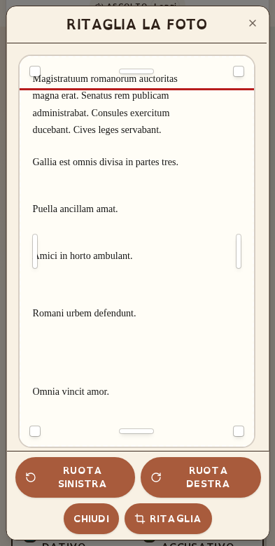

# CLONARE IL SISTEMA PHOTO CROP IN UN’ALTRA APP

**Foglio operativo per Marky — versione 28 ottobre 2026, TRASCINAMENTO DIRETTO SENZA ICONA CENTRALE.**

## Come usarlo (per il docente)

Carica **questo file Markdown in una nuova chat dell’app di destinazione** e scrivi:

> Marky, applica a questa app il sistema photo crop descritto nel foglio allegato.
> Usa i sorgenti inclusi; conserva il resto dell’app. Verifica tu desktop,
> mobile e iframe e mostrami l’anteprima, senza pubblicare in produzione.

Il file contiene istruzioni **e tutti i sorgenti testuali**: non è necessario
avere accesso alla chat precedente, alla sua sandbox o alla repository di
Latino Facile. Il piccolo ZIP `PHOTO-CROPPER-KIT-8731.zip` è un modo
più comodo di ottenere gli stessi sorgenti già separati, ma è facoltativo.
L’illustrazione è facoltativa e non serve per ricostruire il sistema.

## 1. Mandato per Marky

Intervieni sull’app indicata dall’utente, NON clonare tutta Latino Facile.
Prima di scrivere codice leggi README, istruzioni dell’app, struttura,
package.json, UI Dialog/Button, CSS e sistema iframe della **destinazione**.
Salva un checkpoint, annota lo stato iniziale e integra il sistema qui incluso
con una patch minima. Non cancellare dati, non cambiare quiz/esercizi,
autenticazione, PDF, database, traduzione o analizzatore della destinazione.
Non usare gli URL o i contenuti di Latino Facile come destinazione del trapianto.
I percorsi `client/src/...` nell’appendice sono RELATIVI e vanno adattati alla
struttura reale; non sono cartelle da cercare in una sandbox precedente.
Se l’app è Next/SSR, isolare i componenti browser con `use client` e chiamare
initHeightSync solo sul client. Per framework diversi non promettere una
copia diretta React: portare il comportamento preservando gli invarianti.

## 2. Cosa significa “tutto il photo crop”

La catena da trasferire è **SCATTA/CARICA → validazione file → orientamento
EXIF → ritaglio manuale → File PNG → callback dell’app**. Include rotazione,
otto maniglie, spostamento, tastiera, scroll touch interno, blocco e
ripristino della pagina, viewport visibile nel blog e sospensione dei resize
iframe. Il ritaglio è locale nel browser: non richiede IA, API key o server.

**L’OCR è a valle, non è il ritaglio.** Collegare il PNG allo strumento
OCR/IA GIÀ presente nella destinazione, se richiesto, mantenendo lingua,
prompt, limiti e backend di quell’app. Non importare il prompt latino,
server/routers.ts, glossari, traduzione, tRPC o database della sorgente.
`imagePrep.ts` include `enhanceForOcr` come utilità opzionale; non viene usata
per alterare automaticamente il crop. Non inviare foto a servizi esterni
prima che l’utente prema RITAGLIA. Nessuna analisi o soluzione automatica.

## 3. Aspetto e comportamento da preservare

- Sfondo uniforme beige `#f8f1e4`, compresa testata e area foto.
- Titolo: **RITAGLIA LA FOTO**. Nessuna istruzione o sottotitolo sotto il
  titolo. Mantenere il nome accessibile del dialogo e le etichette delle
  maniglie; `aria-describedby={undefined}` perché il sottotitolo è assente.
- **UN SOLO RIQUADRO** (`data-crop-controls` e `data-crop-footer`, role=group)
  contiene RUOTA SINISTRA, RUOTA DESTRA, CHIUDI e RITAGLIA, tutti figli diretti,
  centrati e marroni `#a85b3c`, hover `#96603f`, scritta bianca, grassetto,
  forma a pillola, compatti (14px alla scala base). **AZZERA NON esiste.**
  Non separare rotazioni e azioni in due pannelli. Flex-wrap centra ogni
  riga, align-items:stretch uniforma le altezze; una riga su desktop, due
  se necessario su mobile, target almeno 44px e larghezza max 50% meno gap.
  Non ripristinare ANNULLA / CONFERMA TAGLIO o pulsanti a tutta larghezza.
- CHIUDI annulla senza inviare immagini e senza modificare i contenuti;
  RITAGLIA passa una sola volta al consumer il PNG e il consumer chiude.
  Restano disponibili X ed Escape. Durante il canvas è mostrato ATTENDI….
- Solo titolo e foto scorrono in UN corpo
  `min-h-0 flex-1 overflow-y-auto overscroll-contain touch-pan-y`, senza
  pulsanti. I quattro comandi sono nel medesimo riquadro inferiore visibile;
  nessuna linea divisoria tra righe o famiglie di pulsanti.
- `modal={true}` solo per CropDialog; non cambiare indiscriminatamente gli
  altri dialoghi dell’app. Preservare la gestione focus di Radix.
- Foto ingrandita solo visivamente con `MIN_IMG_W=560`, limitata alla
  larghezza disponibile meno i bordi, SENZA deformarla. Crop in percentuale
  sull’originale, non sui pixel dell’anteprima.
- Selezione libera tra 8% e 100%, otto maniglie da 44px tutte DENTRO la foto;
  nessuna sidebar o limite al 50%. Deve funzionare anche il lato destro.
- **NESSUNA icona centrale**: l'intera area INTERNA alla selezione è
  trascinabile con dito o mouse (`pointer-events:auto;touch-action:none`).
  Le otto prese ridimensionano. Pan verticale solo sui margini beige,
  testata e aree della foto ESTERNE alla selezione, quando c'è overflow.
  Tastiera: frecce 2%, Maiusc+frecce 10%, anche sui bordi e angoli.
- Pointer capture sul contenitore STABILE della foto, non sulle maniglie
  che si muovono. Gestire un solo pointerId; rilasciare su pointerup,
  pointercancel/lostpointercapture. Listener move non passivo.
- Delta dall'ULTIMO evento e box aggiornato, non dal primo punto del gesto:
  invertendo dopo un limite il riquadro deve reagire subito, senza attendere
  il riassorbimento di un eccesso. Non cambiare cropBox.ts per ottenere ciò.
- Rotazione 90° in PNG; crop finale **PNG lossless, lato lungo massimo
  2200px**. Un’eventuale riduzione JPEG per invio IA avviene DOPO, non qui.
- Mantieni font/preferenze accessibilità dell’app ospitante; non sostituire
  tutto il suo tema. Il kit supporta i font esistenti; i font binari di
  Latino Facile non sono necessari al funzionamento e non sono nel foglio.

## 4. Dipendenze: il componente da solo NON basta

Copia o integra insieme:

| File nell’appendice | Ruolo |
|---|---|
| `client/src/components/CropDialog.tsx` | Interazione, canvas e UI definitiva |
| `client/src/hooks/useCropDialogViewport.ts` | Viewport davvero visibile e lock/ripristino |
| `client/src/lib/cropBox.ts` | Geometria pura: NON riscriverla |
| `client/src/photo-crop.css` | Regole `.lf-crop-*` da importare dopo Tailwind |
| `client/src/lib/imagePrep.ts` | EXIF prima dell’anteprima; pre-OCR opzionale |
| `client/src/components/PhotoCropBridge.tsx` | Adattatore generico SCATTA/CARICA, URL e callback |
| `client/src/components/ui/dialog.tsx`, `button.tsx`, `lib/utils.ts` | Dipendenze UI di riferimento: riusare quelle equivalenti già presenti |
| `client/src/lib/heightSync.ts` | Riferimento per integrare il freeze, NON sovrascrivere il protocollo esistente |
| `client/src/lib/cropBox.test.ts` | Test unitari della geometria |
| `examples/PhotoCropDemo.tsx`, `tests/photo-crop-portable.mjs` | Fixture generica senza OCR e test portabili |
| `tests/crop-mobile.e2e.mjs`, `tests/crop-drag.e2e.mjs` | Test layout e gesti della sorgente: adattare route/campi/OCR per la destinazione |
| `SCROLLING-MOBILE.md` | Spiegazione delle cause e del contratto mobile |
| `DEPENDENCIES.json`, `examples/reference-theme.css` | Dipendenze e tema SOLO di riferimento |

Se mancano Dialog/Button, integra i sorgenti di riferimento in un namespace
locale anziché sovrascrivere i componenti condivisi di altre schermate.
Le utility Tailwind dinamiche dei componenti devono essere comprese nei
percorsi scansionati dal compilatore. L’alias `@/` deve puntare alla src
reale (sia TypeScript sia Vite). Vedi `DEPENDENCIES.json`: aggiungere solo
le dipendenze mancanti, non sostituire package.json o lockfile.

## 5. Lock, viewport e iframe: dettagli che non vanno persi

1. `useCropDialogViewport(open)` salva scrollX/Y, valori E priorità degli
   stili di body/html. Applica `position:fixed !important` al body e top
   negativo; la priorità è intenzionale perché Radix usa relative important.
   Alla chiusura/smontaggio ripristina esattamente stili e posizione.
2. Vista autonoma: `visualViewport`; iframe: sonda fixed e
   `IntersectionObserver.intersectionRect`. `rootBounds` può essere null
   cross-origin. NON usare solo `100dvh`: in un iframe auto-alto può essere
   1500px mentre lo schermo visibile è 780px. Non accedere al DOM esterno.
3. Il modale si posiziona nel rettangolo visibile con 8px di margine e si
   ricalcola al resize/orientamento. Non centrarlo sull’intero iframe.
4. Prima del lock viene impostato `data-lf-crop-open` su html. OGNI invio di
   altezza al parent (anche ping/timer) deve fermarsi finché questo attributo
   è presente. Dopo `lf:crop-closed`, richiedere una misura in animationFrame.
5. Il body fixed NON è la nuova altezza dell’app: senza il freeze la cornice
   collassa. Se c’è già heightSync, integra solo guardia/evento; conserva
   token, filtro source/origin, ping, debounce, soglie e anti-loop dell’ospite.
   Non montare due sistemi di heightSync. Se non esiste ed è richiesto
   l’embed, usare il riferimento allegato e adattare il parent concordato.
6. Nei contenuti embedded neutralizzare i min-height 100vh delle pagine
   rilevanti, senza applicare un reset indiscriminato a tutte le viste.
7. Non servono modifiche al codice embed del blog se usa già il protocollo
   compatibile. In un parent diverso prima verificarne il contratto.
8. Limite reale: non puoi impedire lo scroll di un blog cross-origin per
   tocchi che iniziano FUORI dall’iframe. Non prometterlo.

**Non toccare `confirm()`, `moveBox`, `resizeBox`, `resizeCorner` per correggere
layout, colori o scroll.** Se devi adattare importi o testo, fallo senza
cambiare queste funzioni. Non riscrivere il crop con una libreria diversa.

## 6. Collegare il consumer senza accoppiare il dominio

`CropDialog` espone `open`, `imageUrl`, `onClose`, `onConfirm(File)`.
La callback è sincrona nella firma: per lavoro asincrono usare un wrapper
che chiuda, conservi il File e gestisca esplicitamente promise, busy ed errori.
`PhotoCropBridge` lo fa già. Montare UN crop alla volta; revocare gli object
URL alla chiusura/sostituzione/smontaggio; azzerare l’input per poter
riselezionare lo stesso file. Camera posteriore con capture environment;
CARICA non ha capture. Limite di riferimento 18MB, non un limite del server.
Gli errori di formati non decodificabili vanno dichiarati: accept=image/*
non garantisce supporto HEIC in ogni browser.

Esempio nell’app di destinazione (se usa già una pipeline OCR):

```tsx
<PhotoCropBridge onCropped={async (png) => {
  // Qui chiama la pipeline ESISTENTE dell’app: non è parte del kit.
  const testo = await trascriviFotoGiaPresente(png);
  aggiornaCampoTesto(testo); // lascia la revisione all’utente
}} />
```

Le due funzioni nell’esempio sono segnaposto da collegare alle funzioni reali:
NON lasciarle nel codice finale. Se serve solo acquisire il ritaglio,
consegnare il File all’app senza introdurre OCR o servizi nuovi. Sonner deve
avere un solo Toaster montato a livello app. La fixture include un Toaster
solo per il collaudo isolato.

## 7. Controllo qualità da eseguire autonomamente

Non chiedere al docente di eseguire test o fornire log. Prima delle modifiche
esaminare i test disponibili; dopo eseguire typecheck/build e i test della
geometria. Per React/Vite/Tailwind4, dopo aver integrato l’alias e il CSS:

```bash
pnpm check
pnpm exec vitest run --no-file-parallelism
pnpm build
pnpm exec playwright install chromium
# Route TEMPORANEA /photo-crop-test che monta PhotoCropDemo:
CROP_KIT_URL=http://127.0.0.1:3000 \
CROP_KIT_PATH=/photo-crop-test node tests/photo-crop-portable.mjs
```

La fixture non carica una foto vera e non chiama OCR/IA: genera una figura
SVG di test, prova canvas/rotazione, decodifica il PNG e conta le callback.
Il test portabile copre sei scenari (due telefoni, orizzontale, due iframe
cross-origin e desktop/tastiera); eseguirlo oltre ai test dell’app ospitante.
Rimuovere la route temporanea dal percorso utente prima della consegna.
Il test originale più ampio ha nove scenari: adattare APP/route/textarea e
intercettazione OCR se si vuole riprodurlo nella destinazione, NON spacciarlo
per generico senza adattamenti. Verificare inoltre foto piccole, testi
lunghi, riapertura, X/Escape, contrasto, orientamento e ripristino preferenze.

Nel browser dei test Chromium l’eccezione LocalNetworkAccessChecks serve
solo per gli iframe loopback di test: non aggiungerla alla app o produzione.
Touch emulato NON significa test fisico iOS/Android. PNG reale e risposta
OCR simulata NON significano accuratezza OCR/grammaticale certificata.

## 8. Stato della sorgente e criterio di accettazione

- **Versione PUBBLICATA: deploy 8731**, 28/10/2026, codice
  `3a4159402cb0f674ca2e269007d4cfcefe86bedd`.
- Comprende riquadro unico centrato senza AZZERA, drag diretto senza icona
  centrale, titolo RITAGLIA LA FOTO e nessuna istruzione sotto.
- Aggiornamento di questo foglio e delle guide DOPO il rilascio, senza
  cambiare il runtime pubblicato. Il nuovo trapianto deve essere provato
  nell'app ospite e NON è autorizzato al deploy dalla sola consegna del foglio.
- Il blocco invertendo ai limiti è stato riprodotto sulla base 8730 in tutti
  e quattro gli scenari del nuovo test; nella correzione tutti passano.
  `tests/crop-drag.e2e.mjs` misura otto maniglie, quattro direzioni, capture
  e cancellazione, su mouse/touch/iframe; da adattare alle route dell'ospite.
- Rilascio verificato: typecheck/build riusciti, **64/64 test unitari**;
  **9/9 scenari generali (201 controlli)** e **4/4 drag (143 controlli)**
  ripetuti sul sito pubblico del deploy 8731.
- Kit ricostruito in una fixture separata usando soltanto i file allegati:
  typecheck e build riusciti; **6/6 scenari portabili** passati (PNG reale,
  callback unica, nessun invio con CHIUDI, ripristino stili, touch/iframe).
  La fixture non monta l’analizzatore di Latino Facile e non chiama OCR/IA.
- `confirm()`, geometria, hook viewport e heightSync identici alla versione
  funzionante precedente. L’adattatore generico è distinto dalla sorgente:
  non è una modifica alla logica foto di Latino Facile.

Consegna una sintesi dei file cambiati e delle prove effettivamente svolte,
con i limiti. Salva checkpoint → crea anteprima → condividi URL → chiedi
se pubblicare. Aspetta una conferma esplicita in UN NUOVO messaggio prima
del deploy produzione, anche se la richiesta iniziale dice “clona e pubblica”.



---

# APPENDICE: SORGENTI COMPLETI

Ogni blocco `### FILE: percorso` contiene il file intero, non uno pseudocodice.
Ricrea soltanto i file necessari o integra i blocchi nella struttura esistente.
Le hash in fondo consentono di verificare che il nucleo sia stato trasferito
senza perdite. Non eseguire sostituzioni globali sui file dell’ospite.

### FILE: client/src/components/CropDialog.tsx

````tsx
import { useCallback, useEffect, useRef, useState } from "react"; // useCallback usato da computeDisp
import { Button } from "@/components/ui/button";
import {
  Dialog,
  DialogContent,
  DialogHeader,
  DialogTitle,
} from "@/components/ui/dialog";
import { Crop, Loader2, RotateCcw, RotateCw } from "lucide-react";
import { toast } from "sonner";
import { useCropDialogViewport } from "@/hooks/useCropDialogViewport";
import {
  MIN_BOX,
  moveBox,
  resizeBox,
  resizeCorner,
  type Box,
  type Corner,
  type Edge,
} from "@/lib/cropBox";

/** Spessore della zona di presa per il trascinamento (px), tutta DENTRO la foto */
const HANDLE_SIZE = 44;
const CORNER_SIZE = 44;

/**
 * Ampiezza minima standard (px) della foto MOSTRATA nel ritaglio: anche le
 * foto piccole vengono INGRANDITE (solo a schermo, la foto originale non è
 * toccata) finché il lato lungo non raggiunge questa larghezza, così le
 * maniglie restano sempre agibili a prescindere dalle dimensioni originarie.
 */
const MIN_IMG_W = 560;

type DragState =
  | { mode: "resize"; edge: Edge; start: number; startBox: Box }
  | { mode: "corner"; corner: Corner; startX: number; startY: number; startBox: Box }
  | { mode: "move"; startX: number; startY: number; startBox: Box };

/**
 * Modale di ritaglio della foto: la finestra chiara (bordo tratteggiato) è un
 * box libero. Maniglie (4 bordi + 4 angoli) posizionate TUTTE DENTRO la foto,
 * così non vengono mai tagliate da overflow-hidden — in particolare il lato
 * DESTRO, che prima restava a filo e non si poteva restringere.
 * Il trascinamento usa listener sulla window (non solo sulla maniglia), così
 * il gesto continua anche se il puntatore esce dalla barretta.
 *
 * (28/10: sincronizzato con la gemella «Widget metacognitivo per il calcolo
 * di espressioni» — maniglie da tastiera, PNG lossless, beige #f8f1e4 — con
 * testi adattati al dominio latino.)
 */
export function CropDialog({
  open,
  imageUrl,
  onConfirm,
  onClose,
}: {
  open: boolean;
  imageUrl: string | null;
  onConfirm: (croppedFile: File) => void;
  onClose: () => void;
}) {
  const cropViewport = useCropDialogViewport(open);
  const [box, setBox] = useState<Box>({ x: 0, y: 0, w: 100, h: 100 });
  const [busy, setBusy] = useState(false);
  const [src, setSrc] = useState<string | null>(imageUrl);
  const wrapRef = useRef<HTMLDivElement>(null);
  const dragRef = useRef<(DragState & { pointerId: number; width: number; height: number }) | null>(null);
  const extraUrls = useRef<string[]>([]);
  /** dimensioni MOSTRATE della foto: ingrandite finché il lato lungo non
   *  raggiunge MIN_IMG_W, per poter ritagliare anche le foto piccole */
  const [disp, setDisp] = useState<{ w: number; h: number } | null>(null);
  const stageRef = useRef<HTMLDivElement>(null);
  const natRef = useRef<{ w: number; h: number } | null>(null);

  useEffect(() => {
    if (!open) return;
    setBox({ x: 0, y: 0, w: 100, h: 100 });
    setSrc(imageUrl);
    setDisp(null);
    natRef.current = null;
    extraUrls.current.forEach((u) => URL.revokeObjectURL(u));
    extraUrls.current = [];
    dragRef.current = null;
  }, [open, imageUrl]);

  useEffect(() => {
    return () => {
      extraUrls.current.forEach((u) => URL.revokeObjectURL(u));
      extraUrls.current = [];
    };
  }, []);

  /* Listener globali: il trascinamento non si interrompe se il dito/mouse esce dalla maniglia */
  useEffect(() => {
    const onMove = (e: PointerEvent) => {
      const d = dragRef.current;
      const wrap = wrapRef.current;
      if (!d || !wrap || e.pointerId !== d.pointerId) return;
      if (e.cancelable) e.preventDefault();
      // Incrementi rispetto all'ultimo evento, non all'inizio del gesto:
      // dopo un limite l'inversione risponde subito, senza una zona morta.
      let next: Box;
      if (d.mode === "resize") {
        const position = d.edge === "top" || d.edge === "bottom" ? e.clientY : e.clientX;
        const size = d.edge === "top" || d.edge === "bottom" ? d.height : d.width;
        next = resizeBox(d.startBox, d.edge, ((position - d.start) / size) * 100);
        dragRef.current = { ...d, start: position, startBox: next };
      } else {
        const dxPct = ((e.clientX - d.startX) / d.width) * 100;
        const dyPct = ((e.clientY - d.startY) / d.height) * 100;
        next = d.mode === "corner"
          ? resizeCorner(d.startBox, d.corner, dxPct, dyPct)
          : moveBox(d.startBox, dxPct, dyPct);
        dragRef.current = { ...d, startX: e.clientX, startY: e.clientY, startBox: next };
      }
      setBox(next);
    };
    const onUp = (e: PointerEvent) => {
      if (dragRef.current?.pointerId !== e.pointerId) return;
      dragRef.current = null;
      const wrap = wrapRef.current;
      if (wrap?.hasPointerCapture(e.pointerId)) wrap.releasePointerCapture(e.pointerId);
    };
    window.addEventListener("pointermove", onMove, { passive: false });
    window.addEventListener("pointerup", onUp);
    window.addEventListener("pointercancel", onUp);
    return () => {
      window.removeEventListener("pointermove", onMove);
      window.removeEventListener("pointerup", onUp);
      window.removeEventListener("pointercancel", onUp);
    };
  }, []);

  /** Calcola le dimensioni mostrate: entra nello spazio disponibile, ma MAI
   *  sotto l'ampiezza minima standard (il lato lungo scala fino a MIN_IMG_W:
   *  se serve, il contenitore scorre). Il ritaglio è in percentuale, quindi
   *  l'ingrandimento a schermo NON altera il taglio della foto originale. */
  const computeDisp = useCallback((natW: number, natH: number) => {
    if (!natW || !natH) return;
    natRef.current = { w: natW, h: natH };
    // I 4px del bordo non devono comprimere l'immagine solo in larghezza.
    const availW = Math.max(1, (stageRef.current?.clientWidth ?? MIN_IMG_W) - 4);
    const maxH = Math.round((cropViewport?.height ?? window.innerHeight) * 0.58);
    let scale = Math.min(availW / natW, maxH / natH);
    /* 26/10y (mantenuto da Latino Facile): l'ingrandimento delle foto piccole
       (MIN_IMG_W) non deve MAI superare la larghezza disponibile, altrimenti
       su mobile l'anteprima esce DEFORMATA (CSS la comprime in larghezza ma
       l'altezza resta calcolata per 560 px). Il ritaglio usa percentuali:
       resta identico. */
    scale = Math.max(
      scale,
      Math.min(MIN_IMG_W / Math.max(natW, natH), availW / natW)
    );
    setDisp({ w: Math.round(natW * scale), h: Math.round(natH * scale) });
  }, [cropViewport?.height]);

  /* Ricalcola l'ingrandimento quando la finestra cambia dimensione */
  useEffect(() => {
    const onResize = () => {
      if (natRef.current) computeDisp(natRef.current.w, natRef.current.h);
    };
    onResize();
    window.addEventListener("resize", onResize);
    return () => window.removeEventListener("resize", onResize);
  }, [computeDisp]);

  const startDrag = (e: React.PointerEvent, state: DragState) => {
    if (busy || !e.isPrimary || e.button !== 0 || dragRef.current) return;
    const wrap = wrapRef.current;
    if (!wrap) return;
    const rect = wrap.getBoundingClientRect();
    if (rect.width <= 0 || rect.height <= 0) return;
    e.preventDefault();
    e.stopPropagation();
    // Cattura sul contenitore della FOTO: è stabile mentre maniglie e box
    // si spostano. Nessuna perdita di eventi quando il dito esce dalla presa.
    wrap.setPointerCapture(e.pointerId);
    dragRef.current = { ...state, pointerId: e.pointerId, width: rect.width, height: rect.height };
  };

  const onMoveKeyDown = (e: React.KeyboardEvent<HTMLDivElement>) => {
    const step = e.shiftKey ? 10 : 2;
    let dx = 0;
    let dy = 0;
    if (e.key === "ArrowLeft") dx = -step;
    else if (e.key === "ArrowRight") dx = step;
    else if (e.key === "ArrowUp") dy = -step;
    else if (e.key === "ArrowDown") dy = step;
    else return;
    e.preventDefault();
    setBox((prev) => moveBox(prev, dx, dy));
  };

  /* (27/10, collaudo) anche le maniglie dei lati e degli angoli si usano da
     tastiera: frecce = 2% (Maiusc = 10%). Freccia verso l'ESTERNO allarga,
     verso l'interno stringe il lato (per gli angoli muovono l'angolo). */
  const onEdgeKeyDown = (edge: Edge) => (e: React.KeyboardEvent<HTMLDivElement>) => {
    const step = e.shiftKey ? 10 : 2;
    let d = 0;
    if (edge === "top" || edge === "bottom") {
      if (e.key === "ArrowUp") d = -step;
      else if (e.key === "ArrowDown") d = step;
      else return;
    } else {
      if (e.key === "ArrowLeft") d = -step;
      else if (e.key === "ArrowRight") d = step;
      else return;
    }
    e.preventDefault();
    setBox((prev) => resizeBox(prev, edge, d));
  };
  const onCornerKeyDown = (corner: Corner) => (e: React.KeyboardEvent<HTMLDivElement>) => {
    const step = e.shiftKey ? 10 : 2;
    let dx = 0;
    let dy = 0;
    if (e.key === "ArrowLeft") dx = -step;
    else if (e.key === "ArrowRight") dx = step;
    else if (e.key === "ArrowUp") dy = -step;
    else if (e.key === "ArrowDown") dy = step;
    else return;
    e.preventDefault();
    setBox((prev) => resizeCorner(prev, corner, dx, dy));
  };

  const rotate90 = async (dir: 1 | -1) => {
    if (!src || busy) return;
    setBusy(true);
    try {
      const img = new Image();
      img.src = src;
      await new Promise<void>((resolve, reject) => {
        img.onload = () => resolve();
        img.onerror = () => reject(new Error("immagine non caricabile"));
      });
      const canvas = document.createElement("canvas");
      canvas.width = img.naturalHeight;
      canvas.height = img.naturalWidth;
      const ctx = canvas.getContext("2d");
      if (!ctx) throw new Error("canvas non disponibile");
      if (dir === 1) {
        ctx.translate(canvas.width, 0);
        ctx.rotate(Math.PI / 2);
      } else {
        ctx.translate(0, canvas.height);
        ctx.rotate(-Math.PI / 2);
      }
      ctx.drawImage(img, 0, 0);
      /* PNG lossless anche qui: la ruotata diventa la sorgente del ritaglio */
      const blob = await new Promise<Blob | null>((resolve) => canvas.toBlob(resolve, "image/png"));
      if (!blob) throw new Error("impossibile ruotare");
      const url = URL.createObjectURL(blob);
      extraUrls.current.push(url);
      setSrc(url);
      setBox({ x: 0, y: 0, w: 100, h: 100 });
    } catch {
      toast.error("Non sono riuscito a ruotare la foto. Riprova.");
    } finally {
      setBusy(false);
    }
  };

  const confirm = async () => {
    if (!src) return;
    setBusy(true);
    try {
      const img = new Image();
      img.src = src;
      await new Promise<void>((resolve, reject) => {
        img.onload = () => resolve();
        img.onerror = () => reject(new Error("immagine non caricabile"));
      });
      const nw = img.naturalWidth;
      const nh = img.naturalHeight;
      const sx = (nw * box.x) / 100;
      const sy = (nh * box.y) / 100;
      const sw = (nw * box.w) / 100;
      const sh = (nh * box.h) / 100;
      if (sw < 8 || sh < 8) throw new Error("ritaglio troppo piccolo");
      /* Il ritaglio va all'OCR in PNG lossless: il JPEG (blocchi DCT), dopo
         l'ingrandimento per l'OCR, si trasforma in rumore che affoga
         Tesseract (verificato con sonde A/B). Lato massimo 2200 px:
         abbastanza per gli apici, file leggero. */
      const MAX_CROP_EDGE = 2200;
      let cw = Math.max(1, Math.round(sw));
      let ch = Math.max(1, Math.round(sh));
      const cropMax = Math.max(cw, ch);
      if (cropMax > MAX_CROP_EDGE) {
        const s = MAX_CROP_EDGE / cropMax;
        cw = Math.max(1, Math.round(cw * s));
        ch = Math.max(1, Math.round(ch * s));
      }
      const canvas = document.createElement("canvas");
      canvas.width = cw;
      canvas.height = ch;
      const ctx = canvas.getContext("2d");
      if (!ctx) throw new Error("canvas non disponibile");
      ctx.imageSmoothingEnabled = true;
      ctx.imageSmoothingQuality = "high";
      ctx.drawImage(img, sx, sy, sw, sh, 0, 0, cw, ch);
      const blob = await new Promise<Blob | null>((resolve) => canvas.toBlob(resolve, "image/png"));
      if (!blob) throw new Error("impossibile generare il file");
      extraUrls.current.forEach((u) => URL.revokeObjectURL(u));
      extraUrls.current = [];
      onConfirm(new File([blob], "foto_ritagliata.png", { type: "image/png" }));
    } catch {
      toast.error("Non sono riuscito a ritagliare la foto: allarga un po' la finestra e riprova.");
    } finally {
      setBusy(false);
    }
  };

  const rx = 100 - box.x - box.w;
  const by = 100 - box.y - box.h;
  const cropActive = box.w < 100 || box.h < 100;

  /** Maniglie interamente DENTRO il box (mai a cavallo del bordo → mai tagliate). */
  const handleStyle = (edge: Edge): React.CSSProperties => {
    switch (edge) {
      case "top":
        return {
          left: `${box.x}%`,
          top: `${box.y}%`,
          width: `${box.w}%`,
          height: HANDLE_SIZE,
        };
      case "bottom":
        return {
          left: `${box.x}%`,
          top: `calc(${box.y + box.h}% - ${HANDLE_SIZE}px)`,
          width: `${box.w}%`,
          height: HANDLE_SIZE,
        };
      case "left":
        return {
          left: `${box.x}%`,
          top: `${box.y}%`,
          width: HANDLE_SIZE,
          height: `${box.h}%`,
        };
      case "right":
        return {
          left: `calc(${box.x + box.w}% - ${HANDLE_SIZE}px)`,
          top: `${box.y}%`,
          width: HANDLE_SIZE,
          height: `${box.h}%`,
        };
    }
  };

  const cornerStyle = (corner: Corner): React.CSSProperties => {
    switch (corner) {
      case "nw":
        return { top: `${box.y}%`, left: `${box.x}%` };
      case "ne":
        return { top: `${box.y}%`, left: `calc(${box.x + box.w}% - ${CORNER_SIZE}px)` };
      case "sw":
        return { top: `calc(${box.y + box.h}% - ${CORNER_SIZE}px)`, left: `${box.x}%` };
      case "se":
        return {
          top: `calc(${box.y + box.h}% - ${CORNER_SIZE}px)`,
          left: `calc(${box.x + box.w}% - ${CORNER_SIZE}px)`,
        };
    }
  };

  return (
    /* Solo il ritaglio è MODALE: la pagina dietro resta ferma, mentre
       intestazione e foto scorrono; tutti i comandi sono in un unico
       riquadro compatto centrato, separato solo dalla foto.
       Il viewport è quello VISIBILE del blog, non l'altezza dell'iframe. */
    <Dialog
      open={open}
      modal={true}
      onOpenChange={(o) => {
        if (!o) onClose();
      }}
    >
      {/* (27/10, richiesta utente) l'INTERA finestra (testata inclusa) è beige
           #f8f1e4: prima la testata ereditava bg-card (bianco) e spiccava
           rispetto alla parte centrale. */}
      <DialogContent
        className="lf-crop-dialog flex w-[calc(100%-1rem)] max-w-3xl translate-y-0 flex-col gap-0 overflow-hidden bg-[#f8f1e4] p-0 sm:max-w-3xl"
        aria-describedby={undefined}
        style={{
          top: (cropViewport?.top ?? 0) + 8,
          height: cropViewport ? Math.max(1, cropViewport.height - 16) : "calc(100dvh - 1rem)",
          maxHeight: cropViewport ? Math.max(1, cropViewport.height - 16) : "calc(100dvh - 1rem)",
          visibility: cropViewport ? "visible" : "hidden",
        }}
      >
        <div data-crop-scroll className="lf-crop-scroll min-h-0 flex-1 overflow-x-hidden overflow-y-auto overscroll-contain touch-pan-y">
        <DialogHeader className="shrink-0 border-b border-border px-6 py-3 text-center sm:px-12">
          <DialogTitle className="text-xl font-black tracking-tight uppercase text-foreground">
            Ritaglia la foto
          </DialogTitle>
        </DialogHeader>

        {src && (
          <>
            <div className="bg-[#f8f1e4] p-4 sm:p-5">
              <div ref={stageRef} className="flex justify-center">
                <div
                  ref={wrapRef}
                  onLostPointerCapture={(e) => {
                    if (dragRef.current?.pointerId === e.pointerId) dragRef.current = null;
                  }}
                  /* Pan sulle zone esterne alla selezione e sui margini;
                     dentro la selezione si trascina direttamente il crop. */
                  /* (27/10, richiesta utente) sfondo dello specchietto SEMPRE
                     beige #f8f1e4 (stesso beige del corpo della finestra),
                     non più nero; l'oscuramento bg-black/55 attorno al ritaglio
                     resta invariato perché funzionale alla selezione. */
                  className="relative inline-block shrink-0 touch-pan-y select-none overflow-hidden rounded-xl border-2 border-[#d6cec4] bg-[#f8f1e4]"
                >
                   {
                      const el = e.currentTarget;
                      natRef.current = { w: el.naturalWidth, h: el.naturalHeight };
                      computeDisp(el.naturalWidth, el.naturalHeight);
                    }}
                    style={disp ? { width: disp.w, height: disp.h } : undefined}
                    className={
                      disp
                        ? "block max-w-none select-none"
                        : "block max-h-[46dvh] w-auto max-w-full select-none sm:max-h-[58dvh]"
                    }
                  />

                  <div className="pointer-events-none absolute inset-0">
                    <div className="absolute left-0 right-0 bg-black/55" style={{ top: 0, height: `${box.y}%` }} />
                    <div className="absolute left-0 right-0 bg-black/55" style={{ bottom: 0, height: `${by}%` }} />
                    <div
                      className="absolute bg-black/55"
                      style={{ top: `${box.y}%`, height: `${box.h}%`, left: 0, width: `${box.x}%` }}
                    />
                    <div
                      className="absolute bg-black/55"
                      style={{ top: `${box.y}%`, height: `${box.h}%`, right: 0, width: `${rx}%` }}
                    />
                    <div
                      className="absolute border-2 border-dashed border-white/90"
                      style={{ top: `${box.y}%`, left: `${box.x}%`, width: `${box.w}%`, height: `${box.h}%` }}
                    />
                  </div>

                  <div className="absolute inset-0">
                    {cropActive && (
                      <div
                        role="group"
                        aria-label="Sposta la finestra di ritaglio sulla foto"
                        data-crop-selection
                        title="Sposta il ritaglio"
                        tabIndex={0}
                        className="lf-crop-move absolute z-[1] cursor-move select-none outline-none focus-visible:ring-2 focus-visible:ring-white/90 focus-visible:ring-offset-2 focus-visible:ring-offset-black/50"
                        style={{
                          top: `${box.y}%`,
                          left: `${box.x}%`,
                          width: `${box.w}%`,
                          height: `${box.h}%`,
                        }}
                        onPointerDown={(e) =>
                          startDrag(e, { mode: "move", startX: e.clientX, startY: e.clientY, startBox: { ...box } })
                        }
                        onKeyDown={onMoveKeyDown}
                      />
                    )}
                    {(
                      [
                        ["top", "Ridimensiona il lato superiore della finestra di ritaglio", "h-1.5 w-12", "cursor-ns-resize"],
                        ["bottom", "Ridimensiona il lato inferiore della finestra di ritaglio", "h-1.5 w-12", "cursor-ns-resize"],
                        ["left", "Ridimensiona il lato sinistro della finestra di ritaglio", "h-12 w-1.5", "cursor-ew-resize"],
                        ["right", "Ridimensiona il lato destro della finestra di ritaglio", "h-12 w-1.5", "cursor-ew-resize"],
                      ] as const
                    ).map(([edge, label, bar, cursor]) => (
                      <div
                        key={edge}
                        role="slider"
                        aria-label={label}
                        aria-valuemin={MIN_BOX}
                        aria-valuemax={100}
                        aria-valuenow={edge === "left" || edge === "right" ? Math.round(box.w) : Math.round(box.h)}
                        tabIndex={0}
                        onKeyDown={onEdgeKeyDown(edge)}
                        className={`absolute z-[2] flex items-center justify-center touch-none ${cursor}`}
                        style={handleStyle(edge)}
                        onPointerDown={(e) =>
                          startDrag(e, {
                            mode: "resize",
                            edge,
                            start: edge === "top" || edge === "bottom" ? e.clientY : e.clientX,
                            startBox: { ...box },
                          })
                        }
                      >
                        <span className={`${bar} pointer-events-none rounded-full bg-white shadow-md ring-1 ring-black/20`} />
                      </div>
                    ))}
                    {(
                      [
                        ["nw", "Angolo in alto a sinistra", "cursor-nwse-resize"],
                        ["ne", "Angolo in alto a destra", "cursor-nesw-resize"],
                        ["sw", "Angolo in basso a sinistra", "cursor-nesw-resize"],
                        ["se", "Angolo in basso a destra", "cursor-nwse-resize"],
                      ] as const
                    ).map(([corner, label, cursor]) => (
                      <div
                        key={corner}
                        role="slider"
                        aria-label={`Ridimensiona dal ${label.toLowerCase()}`}
                        tabIndex={0}
                        onKeyDown={onCornerKeyDown(corner)}
                        className={`absolute z-[3] flex items-center justify-center touch-none ${cursor}`}
                        style={{ ...cornerStyle(corner), width: CORNER_SIZE, height: CORNER_SIZE }}
                        onPointerDown={(e) =>
                          startDrag(e, {
                            mode: "corner",
                            corner,
                            startX: e.clientX,
                            startY: e.clientY,
                            startBox: { ...box },
                          })
                        }
                      >
                        <span className="pointer-events-none h-3.5 w-3.5 rounded-[3px] bg-white shadow-md ring-1 ring-black/25" />
                      </div>
                    ))}
                  </div>
                </div>
              </div>
            </div>

          </>
        )}
        </div>
        <div data-crop-footer data-crop-controls role="group" aria-label="Comandi per il ritaglio della foto" className="lf-crop-footer shrink-0 border-t border-border bg-[#f8f1e4]">
              <Button
                type="button"
                onClick={() => void rotate90(-1)}
                disabled={busy || !src}
                aria-label="Ruota la foto di 90 gradi a sinistra"
                className="h-auto min-h-11 gap-1.5 rounded-full border-2 border-[#a85b3c] bg-[#a85b3c] px-3 text-sm font-bold uppercase text-white shadow-sm hover:bg-[#96603f]"
              >
                <RotateCcw className="h-4 w-4" aria-hidden="true" />
                Ruota sinistra
              </Button>
              <Button
                type="button"
                onClick={() => void rotate90(1)}
                disabled={busy || !src}
                aria-label="Ruota la foto di 90 gradi a destra"
                className="h-auto min-h-11 gap-1.5 rounded-full border-2 border-[#a85b3c] bg-[#a85b3c] px-3 text-sm font-bold uppercase text-white shadow-sm hover:bg-[#96603f]"
              >
                <RotateCw className="h-4 w-4" aria-hidden="true" />
                Ruota destra
              </Button>
              <Button
                type="button"
                onClick={onClose}
                disabled={busy}
                className="h-auto min-h-11 rounded-full border-2 border-[#a85b3c] bg-[#a85b3c] px-4 text-sm font-bold uppercase text-white shadow-sm hover:bg-[#96603f]"
              >
                Chiudi
              </Button>
              <Button
                type="button"
                onClick={() => void confirm()}
                disabled={busy}
                className="h-auto min-h-11 gap-1.5 rounded-full border-2 border-[#a85b3c] bg-[#a85b3c] px-4 text-sm font-bold uppercase text-white shadow-sm hover:bg-[#96603f]"
              >
                {busy ? <Loader2 className="h-4 w-4 animate-spin" aria-hidden="true" /> : <Crop className="h-4 w-4" aria-hidden="true" />}
                {busy ? "Attendi…" : "Ritaglia"}
              </Button>
        </div>
      </DialogContent>
    </Dialog>
  );
}
````

### FILE: client/src/hooks/useCropDialogViewport.ts

````typescript
import { useLayoutEffect, useState } from "react";

export type CropViewport = { top: number; height: number };

/**
 * Il viewport di un iframe auto-alto NON è lo schermo del telefono.
 * IntersectionObserver fornisce il rettangolo visibile anche cross-origin
 * (rootBounds può essere null). Non si accede al DOM del blog e non si
 * richiede di cambiare il codice embed già pubblicato.
 *
 * Lock limitato al ritaglio: alla chiusura ripristina stili e posizione.
 * Radix modal gestisce focus e touch fuori dalla finestra; qui il body
 * fixed copre anche Safari iOS. heightSync sospende i resize durante il lock.
 */
export function useCropDialogViewport(open: boolean): CropViewport | null {
  const [viewport, setViewport] = useState<CropViewport | null>(null);

  useLayoutEffect(() => {
    if (!open) {
      setViewport(null);
      return;
    }
    const html = document.documentElement;
    const body = document.body;
    const x = window.scrollX;
    const y = window.scrollY;
    const bodyProperties = [
      "position",
      "top",
      "left",
      "width",
      "overflow",
    ] as const;
    const htmlProperties = [
      "overflow",
      "overscroll-behavior",
      "scroll-behavior",
    ] as const;
    const saved = (element: HTMLElement, names: readonly string[]) =>
      names.map(name => ({
        name,
        value: element.style.getPropertyValue(name),
        priority: element.style.getPropertyPriority(name),
      }));
    const bodyStyles = saved(body, bodyProperties);
    const htmlStyles = saved(html, htmlProperties);
    const oldLock = html.getAttribute("data-lf-crop-open");
    // Prima di cambiare layout, congela la sincronizzazione con la cornice.
    html.setAttribute("data-lf-crop-open", "true");
    html.style.setProperty("overflow", "hidden");
    html.style.setProperty("overscroll-behavior", "none");
    html.style.setProperty("scroll-behavior", "auto");
    // react-remove-scroll di Radix imposta position:relative !important.
    // Il lock iOS deve prevalere, altrimenti il body torna a scorrere.
    body.style.setProperty("position", "fixed", "important");
    body.style.setProperty("top", `${-y}px`);
    body.style.setProperty("left", `${-x}px`);
    body.style.setProperty("width", "100%");
    body.style.setProperty("overflow", "hidden");

    const update = (top: number, height: number) => {
      if (height <= 0) return;
      const next = {
        top: Math.max(0, Math.ceil(top)),
        height: Math.floor(height),
      };
      setViewport(previous =>
        previous &&
        Math.abs(previous.top - next.top) < 1 &&
        Math.abs(previous.height - next.height) < 1
          ? previous
          : next
      );
    };
    const embedded = window.self !== window.top;
    const visual = window.visualViewport;
    const measureStandalone = () =>
      update(visual?.offsetTop ?? 0, visual?.height ?? window.innerHeight);
    let probe: HTMLDivElement | null = null;
    let observer: IntersectionObserver | null = null;
    let stopped = false;
    if (embedded && typeof IntersectionObserver !== "undefined") {
      probe = document.createElement("div");
      probe.setAttribute("aria-hidden", "true");
      probe.style.cssText =
        "position:fixed;inset:0;pointer-events:none;visibility:hidden;";
      body.appendChild(probe);
      observer = new IntersectionObserver(
        ([entry]) => {
          if (!stopped && entry?.isIntersecting) {
            update(entry.intersectionRect.top, entry.intersectionRect.height);
          }
        },
        { threshold: Array.from({ length: 101 }, (_, n) => n / 100) }
      );
      observer.observe(probe);
    } else {
      measureStandalone();
      window.addEventListener("resize", measureStandalone);
      visual?.addEventListener("resize", measureStandalone);
      visual?.addEventListener("scroll", measureStandalone);
    }
    return () => {
      stopped = true;
      observer?.disconnect();
      probe?.remove();
      window.removeEventListener("resize", measureStandalone);
      visual?.removeEventListener("resize", measureStandalone);
      visual?.removeEventListener("scroll", measureStandalone);
      const restore = (element: HTMLElement, entries: typeof bodyStyles) => {
        for (const { name, value, priority } of entries) {
          if (value) element.style.setProperty(name, value, priority);
          else element.style.removeProperty(name);
        }
      };
      restore(body, bodyStyles);
      // Prima del ripristino del smooth scroll, ritorna alla posizione esatta.
      window.scrollTo(x, y);
      restore(html, htmlStyles);
      if (oldLock === null) html.removeAttribute("data-lf-crop-open");
      else html.setAttribute("data-lf-crop-open", oldLock);
      window.dispatchEvent(new Event("lf:crop-closed"));
    };
  }, [open]);

  return viewport;
}
````

### FILE: client/src/lib/cropBox.ts

````typescript
/** Geometria della finestra di ritaglio (percentuali 0–100 sulla foto). */

export const MIN_BOX = 8;

export type Box = { x: number; y: number; w: number; h: number };
export type Edge = "top" | "right" | "bottom" | "left";
export type Corner = "nw" | "ne" | "sw" | "se";

export const clamp = (v: number, lo: number, hi: number) => Math.max(lo, Math.min(hi, v));
export const round1 = (n: number) => Math.round(n * 10) / 10;

/** Sposta l'INTERO box di dx/dy %, restando dentro la foto (estremi inclusi). */
export function moveBox(base: Box, dxPct: number, dyPct: number): Box {
  return {
    ...base,
    x: round1(clamp(base.x + dxPct, 0, 100 - base.w)),
    y: round1(clamp(base.y + dyPct, 0, 100 - base.h)),
  };
}

/** Ridimensiona dal bordo indicato (il bordo opposto resta fisso). */
export function resizeBox(base: Box, edge: Edge, deltaPct: number): Box {
  const { x, y, w, h } = base;
  switch (edge) {
    case "top": {
      const ny = round1(clamp(y + deltaPct, 0, y + h - MIN_BOX));
      return { x, y: ny, w, h: round1(y + h - ny) };
    }
    case "bottom": {
      return { x, y, w, h: round1(clamp(h + deltaPct, MIN_BOX, 100 - y)) };
    }
    case "left": {
      const nx = round1(clamp(x + deltaPct, 0, x + w - MIN_BOX));
      return { x: nx, y, w: round1(x + w - nx), h };
    }
    case "right": {
      return { x, y, w: round1(clamp(w + deltaPct, MIN_BOX, 100 - x)), h };
    }
  }
}

/** Ridimensiona da un angolo (i due bordi opposti restano fissi). */
export function resizeCorner(base: Box, corner: Corner, dxPct: number, dyPct: number): Box {
  const { x, y, w, h } = base;
  let nx = x;
  let ny = y;
  let nw = w;
  let nh = h;
  if (corner === "nw" || corner === "sw") {
    nx = round1(clamp(x + dxPct, 0, x + w - MIN_BOX));
    nw = round1(x + w - nx);
  } else {
    nw = round1(clamp(w + dxPct, MIN_BOX, 100 - x));
  }
  if (corner === "nw" || corner === "ne") {
    ny = round1(clamp(y + dyPct, 0, y + h - MIN_BOX));
    nh = round1(y + h - ny);
  } else {
    nh = round1(clamp(h + dyPct, MIN_BOX, 100 - y));
  }
  return { x: nx, y: ny, w: nw, h: nh };
}
````

### FILE: client/src/lib/cropBox.test.ts

````typescript
import { describe, expect, it } from "vitest";
import { MIN_BOX, moveBox, resizeBox, resizeCorner } from "./cropBox";

const full = { x: 0, y: 0, w: 100, h: 100 };

describe("resizeBox — lato destro (il bordo che non si restringeva)", () => {
  it("restringe trascinando verso sinistra (delta negativo)", () => {
    expect(resizeBox(full, "right", -25)).toEqual({ x: 0, y: 0, w: 75, h: 100 });
  });
  it("può arrivare fino a MIN_BOX", () => {
    expect(resizeBox(full, "right", -100).w).toBe(MIN_BOX);
  });
  it("non sfora il bordo destro della foto", () => {
    const shrunk = { x: 10, y: 0, w: 50, h: 100 };
    expect(resizeBox(shrunk, "right", 80).w).toBe(90);
  });
  it("allarga di nuovo dopo un restringimento", () => {
    const mid = { x: 0, y: 0, w: 60, h: 100 };
    expect(resizeBox(mid, "right", 20).w).toBe(80);
  });
});

describe("resizeBox — gli altri tre lati", () => {
  it("sinistra: restringe spostando il bordo verso destra", () => {
    expect(resizeBox(full, "left", 20)).toEqual({ x: 20, y: 0, w: 80, h: 100 });
  });
  it("alto: restringe spostando il bordo verso il basso", () => {
    expect(resizeBox(full, "top", 15)).toEqual({ x: 0, y: 15, w: 100, h: 85 });
  });
  it("basso: restringe con delta negativo", () => {
    expect(resizeBox(full, "bottom", -30)).toEqual({ x: 0, y: 0, w: 100, h: 70 });
  });
});

describe("resizeCorner", () => {
  it("angolo SE restringe larghezza e altezza", () => {
    expect(resizeCorner(full, "se", -20, -10)).toEqual({ x: 0, y: 0, w: 80, h: 90 });
  });
  it("angolo NE restringe da destra e dall'alto", () => {
    expect(resizeCorner(full, "ne", -25, 10)).toEqual({ x: 0, y: 10, w: 75, h: 90 });
  });
});

describe("moveBox", () => {
  it("resta dentro la foto", () => {
    const b = { x: 10, y: 10, w: 40, h: 40 };
    expect(moveBox(b, 80, 80)).toEqual({ x: 60, y: 60, w: 40, h: 40 });
  });
});
````

### FILE: client/src/lib/imagePrep.ts

````typescript
/**
 * Preparazione delle foto prima del ritaglio e dell'OCR.
 *
 * 1. `normalizePhoto` — corregge l'orientamento EXIF (le foto scattate dal
 *    telefono arrivano spesso ruotate di 90°) e restituisce un JPEG "dritto".
 * 2. `enhanceForOcr` — ridimensiona, passa in scala di grigi e stira il
 *    contrasto (ripiego OCR quando l'IA della foto non risponde), così il
 *    riconoscimento legge meglio testo stampato su libro/quaderno
 *    (luci irregolari, pagina gialla, ombre).
 */

const MAX_EDGE = 2200;
const MIN_EDGE = 720;

export async function bitmapFromBlob(blob: Blob): Promise<ImageBitmap> {
  try {
    return await createImageBitmap(blob, { imageOrientation: "from-image" });
  } catch {
    return await createImageBitmap(blob);
  }
}

function canvasToBlob(canvas: HTMLCanvasElement, type: string, quality?: number): Promise<Blob> {
  return new Promise((resolve, reject) => {
    canvas.toBlob((b) => (b ? resolve(b) : reject(new Error("impossibile generare l'immagine"))), type, quality);
  });
}

/** Foto "dritta" in JPEG, pronta da mostrare nel ritaglio. */
export async function normalizePhoto(file: File): Promise<File> {
  const bmp = await bitmapFromBlob(file);
  try {
    const canvas = document.createElement("canvas");
    canvas.width = bmp.width;
    canvas.height = bmp.height;
    const ctx = canvas.getContext("2d");
    if (!ctx) throw new Error("canvas non disponibile");
    ctx.drawImage(bmp, 0, 0);
    const blob = await canvasToBlob(canvas, "image/jpeg", 0.92);
    return new File([blob], "foto.jpg", { type: "image/jpeg" });
  } finally {
    bmp.close();
  }
}

/**
 * Stira il contrasto in scala di grigi (percentili 2–98) per testo scuro su
 * carta chiara. Non usa una soglia dura: conserva l'antialias delle lettere.
 */
function contrastStretchGray(img: ImageData): void {
  const { data } = img;
  const n = data.length / 4;
  if (n === 0) return;
  const hist = new Uint32Array(256);
  for (let i = 0; i < data.length; i += 4) {
    const y = Math.round(0.299 * data[i] + 0.587 * data[i + 1] + 0.114 * data[i + 2]);
    hist[y]++;
    data[i] = y;
    data[i + 1] = y;
    data[i + 2] = y;
  }
  const loCount = Math.max(1, Math.floor(n * 0.02));
  const hiCount = Math.max(1, Math.floor(n * 0.02));
  let acc = 0;
  let lo = 0;
  for (let v = 0; v < 256; v++) {
    acc += hist[v];
    if (acc >= loCount) {
      lo = v;
      break;
    }
  }
  acc = 0;
  let hi = 255;
  for (let v = 255; v >= 0; v--) {
    acc += hist[v];
    if (acc >= hiCount) {
      hi = v;
      break;
    }
  }
  if (hi <= lo) return;
  const scale = 255 / (hi - lo);
  for (let i = 0; i < data.length; i += 4) {
    const y = Math.max(0, Math.min(255, Math.round((data[i] - lo) * scale)));
    data[i] = y;
    data[i + 1] = y;
    data[i + 2] = y;
  }
}

/** Immagine ottimizzata per Tesseract (PNG lossless, grigio, contrasto). */
export async function enhanceForOcr(file: Blob): Promise<Blob> {
  const bmp = await bitmapFromBlob(file);
  try {
    let scale = 1;
    const maxEdge = Math.max(bmp.width, bmp.height);
    const minEdge = Math.min(bmp.width, bmp.height);
    if (maxEdge > MAX_EDGE) scale = MAX_EDGE / maxEdge;
    else if (minEdge < MIN_EDGE) scale = MIN_EDGE / minEdge;
    const cw = Math.max(1, Math.round(bmp.width * scale));
    const ch = Math.max(1, Math.round(bmp.height * scale));
    const canvas = document.createElement("canvas");
    canvas.width = cw;
    canvas.height = ch;
    const ctx = canvas.getContext("2d");
    if (!ctx) throw new Error("canvas non disponibile");
    ctx.imageSmoothingEnabled = true;
    ctx.imageSmoothingQuality = "high";
    ctx.drawImage(bmp, 0, 0, cw, ch);
    const img = ctx.getImageData(0, 0, cw, ch);
    contrastStretchGray(img);
    ctx.putImageData(img, 0, 0);
    return await canvasToBlob(canvas, "image/png");
  } finally {
    bmp.close();
  }
}
````

### FILE: client/src/components/ui/dialog.tsx

````tsx
import { cn } from "@/lib/utils";
import * as DialogPrimitive from "@radix-ui/react-dialog";
import { XIcon } from "lucide-react";
import * as React from "react";

// Context to track composition state across dialog children
const DialogCompositionContext = React.createContext<{
  isComposing: () => boolean;
  setComposing: (composing: boolean) => void;
  justEndedComposing: () => boolean;
  markCompositionEnd: () => void;
}>({
  isComposing: () => false,
  setComposing: () => {},
  justEndedComposing: () => false,
  markCompositionEnd: () => {},
});

export const useDialogComposition = () =>
  React.useContext(DialogCompositionContext);

function Dialog({
  ...props
}: React.ComponentProps<typeof DialogPrimitive.Root>) {
  const composingRef = React.useRef(false);
  const justEndedRef = React.useRef(false);
  const endTimerRef = React.useRef<ReturnType<typeof setTimeout> | null>(null);

  const contextValue = React.useMemo(
    () => ({
      isComposing: () => composingRef.current,
      setComposing: (composing: boolean) => {
        composingRef.current = composing;
      },
      justEndedComposing: () => justEndedRef.current,
      markCompositionEnd: () => {
        justEndedRef.current = true;
        if (endTimerRef.current) {
          clearTimeout(endTimerRef.current);
        }
        endTimerRef.current = setTimeout(() => {
          justEndedRef.current = false;
        }, 150);
      },
    }),
    []
  );

  return (
    <DialogCompositionContext.Provider value={contextValue}>
      <DialogPrimitive.Root data-slot="dialog" {...props} />
    </DialogCompositionContext.Provider>
  );
}

function DialogTrigger({
  ...props
}: React.ComponentProps<typeof DialogPrimitive.Trigger>) {
  return <DialogPrimitive.Trigger data-slot="dialog-trigger" {...props} />;
}

function DialogPortal({
  ...props
}: React.ComponentProps<typeof DialogPrimitive.Portal>) {
  return <DialogPrimitive.Portal data-slot="dialog-portal" {...props} />;
}

function DialogClose({
  ...props
}: React.ComponentProps<typeof DialogPrimitive.Close>) {
  return <DialogPrimitive.Close data-slot="dialog-close" {...props} />;
}

function DialogOverlay({
  className,
  ...props
}: React.ComponentProps<typeof DialogPrimitive.Overlay>) {
  return (
    <DialogPrimitive.Overlay
      data-slot="dialog-overlay"
      className={cn(
        "data-[state=open]:animate-in data-[state=closed]:animate-out data-[state=closed]:fade-out-0 data-[state=open]:fade-in-0 fixed inset-0 z-50 bg-black/50",
        className
      )}
      {...props}
    />
  );
}

DialogOverlay.displayName = "DialogOverlay";

function DialogContent({
  className,
  children,
  showCloseButton = true,
  onEscapeKeyDown,
  ...props
}: React.ComponentProps<typeof DialogPrimitive.Content> & {
  showCloseButton?: boolean;
}) {
  const { isComposing } = useDialogComposition();

  const handleEscapeKeyDown = React.useCallback(
    (e: KeyboardEvent) => {
      // Check both the native isComposing property and our context state
      // This handles Safari's timing issues with composition events
      const isCurrentlyComposing = (e as any).isComposing || isComposing();

      // If IME is composing, prevent dialog from closing
      if (isCurrentlyComposing) {
        e.preventDefault();
        return;
      }

      // Call user's onEscapeKeyDown if provided
      onEscapeKeyDown?.(e);
    },
    [isComposing, onEscapeKeyDown]
  );

  return (
    <DialogPortal data-slot="dialog-portal">
      <DialogOverlay />
      <DialogPrimitive.Content
        data-slot="dialog-content"
        className={cn(
          "bg-background data-[state=open]:animate-in data-[state=closed]:animate-out data-[state=closed]:fade-out-0 data-[state=open]:fade-in-0 data-[state=closed]:zoom-out-95 data-[state=open]:zoom-in-95 fixed top-[50%] left-[50%] z-50 grid w-full max-w-[calc(100%-2rem)] translate-x-[-50%] translate-y-[-50%] gap-4 rounded-lg border p-6 shadow-lg duration-200 sm:max-w-lg",
          className
        )}
        onEscapeKeyDown={handleEscapeKeyDown}
        {...props}
      >
        {children}
        {showCloseButton && (
          <DialogPrimitive.Close
            data-slot="dialog-close"
            className="ring-offset-background focus:ring-ring data-[state=open]:bg-accent data-[state=open]:text-muted-foreground absolute top-4 right-4 rounded-xs opacity-70 transition-opacity hover:opacity-100 focus:ring-2 focus:ring-offset-2 focus:outline-hidden disabled:pointer-events-none [&_svg]:pointer-events-none [&_svg]:shrink-0 [&_svg:not([class*='size-'])]:size-4"
          >
            <XIcon />
            <span className="sr-only">Close</span>
          </DialogPrimitive.Close>
        )}
      </DialogPrimitive.Content>
    </DialogPortal>
  );
}

function DialogHeader({ className, ...props }: React.ComponentProps<"div">) {
  return (
    <div
      data-slot="dialog-header"
      className={cn("flex flex-col gap-2 text-center sm:text-left", className)}
      {...props}
    />
  );
}

function DialogFooter({ className, ...props }: React.ComponentProps<"div">) {
  return (
    <div
      data-slot="dialog-footer"
      className={cn(
        "flex flex-col-reverse gap-2 sm:flex-row sm:justify-end",
        className
      )}
      {...props}
    />
  );
}

function DialogTitle({
  className,
  ...props
}: React.ComponentProps<typeof DialogPrimitive.Title>) {
  return (
    <DialogPrimitive.Title
      data-slot="dialog-title"
      className={cn("text-lg leading-none font-semibold", className)}
      {...props}
    />
  );
}

function DialogDescription({
  className,
  ...props
}: React.ComponentProps<typeof DialogPrimitive.Description>) {
  return (
    <DialogPrimitive.Description
      data-slot="dialog-description"
      className={cn("text-muted-foreground text-sm", className)}
      {...props}
    />
  );
}

export {
  Dialog,
  DialogClose,
  DialogContent,
  DialogDescription,
  DialogFooter,
  DialogHeader,
  DialogOverlay,
  DialogPortal,
  DialogTitle,
  DialogTrigger
};

````

### FILE: client/src/components/ui/button.tsx

````tsx
import * as React from "react";
import { Slot } from "@radix-ui/react-slot";
import { cva, type VariantProps } from "class-variance-authority";

import { cn } from "@/lib/utils";

const buttonVariants = cva(
  "inline-flex items-center justify-center gap-2 whitespace-nowrap rounded-md text-sm font-medium transition-all disabled:pointer-events-none disabled:opacity-50 [&_svg]:pointer-events-none [&_svg:not([class*='size-'])]:size-4 shrink-0 [&_svg]:shrink-0 outline-none focus-visible:border-ring focus-visible:ring-ring/50 focus-visible:ring-[3px] aria-invalid:ring-destructive/20 dark:aria-invalid:ring-destructive/40 aria-invalid:border-destructive",
  {
    variants: {
      variant: {
        default: "bg-primary text-primary-foreground hover:bg-primary/90",
        destructive:
          "bg-destructive text-white hover:bg-destructive/90 focus-visible:ring-destructive/20 dark:focus-visible:ring-destructive/40 dark:bg-destructive/60",
        outline:
          "border bg-transparent shadow-xs hover:bg-accent dark:bg-transparent dark:border-input dark:hover:bg-input/50",
        secondary:
          "bg-secondary text-secondary-foreground hover:bg-secondary/80",
        ghost:
          "hover:bg-accent dark:hover:bg-accent/50",
        link: "text-primary underline-offset-4 hover:underline",
      },
      size: {
        default: "h-9 px-4 py-2 has-[>svg]:px-3",
        sm: "h-8 rounded-md gap-1.5 px-3 has-[>svg]:px-2.5",
        lg: "h-10 rounded-md px-6 has-[>svg]:px-4",
        icon: "size-9",
        "icon-sm": "size-8",
        "icon-lg": "size-10",
      },
    },
    defaultVariants: {
      variant: "default",
      size: "default",
    },
  }
);

function Button({
  className,
  variant,
  size,
  asChild = false,
  ...props
}: React.ComponentProps<"button"> &
  VariantProps<typeof buttonVariants> & {
    asChild?: boolean;
  }) {
  const Comp = asChild ? Slot : "button";

  return (
    <Comp
      data-slot="button"
      className={cn(buttonVariants({ variant, size, className }))}
      {...props}
    />
  );
}

export { Button, buttonVariants };
````

### FILE: client/src/lib/utils.ts

````typescript
import { clsx, type ClassValue } from "clsx";
import { twMerge } from "tailwind-merge";

export function cn(...inputs: ClassValue[]) {
  return twMerge(clsx(inputs));
}
````

### FILE: client/src/lib/heightSync.ts

````typescript
/**
 * Sincronizzazione altezza per embed iframe (protocollo `labvisivo:height`).
 *
 * Quando l'app è caricata dentro un iframe (es. cornice dinamica su Blogger
 * o su un sito), invia al parent l'altezza reale del documento così la
 * cornice può adattarsi automaticamente al contenuto (resize automatico).
 *
 * Il parent ascolta messaggi del tipo:
 *   { type: "labvisivo:height", height: <numero> }
 */

function currentHeight(): number {
  const docEl = document.documentElement;
  const body = document.body;
  /* IMPORTANTE: NON usare documentElement.scrollHeight come riferimento
     assoluto. Quando il contenuto è più corto dell'iframe, lo scrollHeight
     del documento resta “gonfiato” all'altezza del viewport dell'iframe
     (mai meno), quindi la cornice dinamica non potrebbe MAI restringersi
     e la prima pagina mostrerebbe un grande vuoto (prima sotto la card,
     poi sopra). Usiamo invece l'altezza reale del contenuto (body +
     offsetHeight del documento) e aggiungiamo documentElement.scrollHeight
     SOLO quando il contenuto supera davvero il viewport. */
  const viewportH = window.innerHeight || (docEl ? docEl.clientHeight : 0);
  let h = Math.max(
    body ? body.scrollHeight : 0,
    body ? body.offsetHeight : 0,
    docEl ? docEl.offsetHeight : 0
  );
  if (docEl && docEl.scrollHeight > viewportH) {
    h = Math.max(h, docEl.scrollHeight);
  }
  return h;
}

// Token univoco della cornice (parametro ?cornice=... nell'URL dell'iframe).
// La cornice dinamica genera un token per OGNI istanza e lo ripassa qui;
// l'app lo rispecchia nei messaggi di altezza, così la cornice accetta solo
// i messaggi del PROPRIO iframe (impermeabilità tra più cornici nella stessa
// pagina, es. blog con più app didattiche embeddate).
function corniceToken(): string {
  try {
    const p = new URLSearchParams(window.location.search);
    return p.get("cornice") || "";
  } catch {
    return "";
  }
}

/* 26/10t ANTI-TREMOLIO: la cornice dinamica tremava perché ad ogni piccola
   variazione (1-2 px da font/arrotondamenti/scrollbar) l'app inviava una
   nuova altezza e la cornice ridimensionava l'iframe, innescando un nuovo
   cambio di altezza (loop ping-pong). Ora:
   - l'altezza viene ARROTONDATA al multiplo di 8 px (le micro-variazioni
     spariscono);
   - sotto una TOLLERANZA di 12 px rispetto all'ultima altezza inviata non
     si invia nulla (isteresi: la cornice resta ferma). */
let lastSentHeight = 0;
const HEIGHT_ROUND = 8;
const HEIGHT_TOLERANCE = 12;

function sendHeight(token: string = corniceToken()): void {
  // Attivo solo quando siamo dentro un iframe (non come pagina principale)
  if (window.self === window.top) return;
  // Il body fixed del ritaglio non è la nuova altezza dell'app: non
  // restringere la cornice mentre il modale è aperto (né ad ogni ping).
  if (document.documentElement.hasAttribute("data-lf-crop-open")) return;
  const raw = currentHeight();
  if (raw <= 100) return;
  const height = Math.round(raw / HEIGHT_ROUND) * HEIGHT_ROUND;
  if (Math.abs(height - lastSentHeight) < HEIGHT_TOLERANCE) return;
  lastSentHeight = height;
  const msg: { type: string; height: number; cornice?: string } = {
    type: "labvisivo:height",
    height,
  };
  if (token) msg.cornice = token;
  window.parent.postMessage(msg, "*");
}

export function initHeightSync(): void {
  // IMPORTANTE: quando l'app è dentro un iframe a altezza automatica
  // (cornice dinamica), la pagina deve seguire l'altezza del CONTENUTO.
  // Il classico `min-h-screen` (100vh) creerebbe un loop infinito:
  //   iframe = misurato → viewport = iframe → misurato = viewport + barra → …
  // Con la classe `lf-embedded` il CSS disattiva i 100vh (vedi index.css).
  if (window.self !== window.top) {
    document.documentElement.classList.add("lf-embedded");
  }

  // Risponde al "ping" della cornice dinamica (embed Blogger): la cornice
  // può richiedere l'altezza in ogni momento con { type: "labvisivo:ping" }.
  // Se il ping porta il token della cornice, lo rispecchiamo nella risposta.
  window.addEventListener("message", (e) => {
    if (e.data && e.data.type === "labvisivo:ping") {
      sendHeight(typeof e.data.cornice === "string" ? e.data.cornice : corniceToken());
    }
  });

  // Invia subito (prima del rendering completo) e a caricamento avvenuto
  sendHeight();
  window.addEventListener("load", () => sendHeight());
  window.addEventListener("resize", () => sendHeight());
  window.addEventListener("lf:crop-closed", () => requestAnimationFrame(() => sendHeight()));

  // Osserva i cambi di layout: analisi frasi, OCR, dialoghi, traduzione…
  // (26/10t: il ResizeObserver scatta ANCHE quando è la cornice stessa a
  // ridimensionare l'iframe — senza debounce alimentava il loop del
  // tremolio: ora le chiamate ravvicinate vengono accorpate in una sola.)
  if (typeof ResizeObserver !== "undefined") {
    let roTimer: ReturnType<typeof setTimeout> | null = null;
    const ro = new ResizeObserver(() => {
      if (roTimer) clearTimeout(roTimer);
      roTimer = setTimeout(() => {
        roTimer = null;
        sendHeight();
      }, 150);
    });
    if (document.documentElement) ro.observe(document.documentElement);
    if (document.body) ro.observe(document.body);
    // Invia anche quando un dialogo si apre/chiude (il body cambia dimensione)
    setTimeout(() => sendHeight(), 250);
  }

  // Retry: font, OCR e contenuti asincroni possono cambiare l'altezza dopo
  // l'evento "load" (es. tesseract.js carica i dati in background)
  setTimeout(sendHeight, 500);
  setTimeout(sendHeight, 1500);
}
````

### FILE: tests/crop-mobile.e2e.mjs

````javascript
import { chromium } from 'playwright';
import fs from 'node:fs/promises';
// Avviare prima pnpm dev sulla porta 3000. Nessuna richiesta IA reale.
const BASE=process.env.CROP_QA_BASE_URL ?? 'http://127.0.0.1:3000';
const APP=BASE+'/app?nome=QA&cognome=Test&classe=2A&data=28%2F10%2F2026';
const out=process.env.CROP_QA_OUTPUT ?? new URL('../.cache/crop-mobile-qa',import.meta.url).pathname;
await fs.mkdir(out,{recursive:true});
const photo=Buffer.from(`<svg xmlns="http://www.w3.org/2000/svg" width="900" height="1500"><rect width="900" height="1500" fill="#fffdf6"/><g font-family="serif" font-size="38" fill="#111"><text x="50" y="100">Magistratuum romanorum auctoritas</text><text x="50" y="165">magna erat. Senatus rem publicam</text><text x="50" y="230">administrabat. Consules exercitum</text><text x="50" y="295">ducebant. Cives leges servabant.</text><text x="50" y="420">Gallia est omnis divisa in partes tres.</text><text x="50" y="600">Puella ancillam amat.</text><text x="50" y="780">Amici in horto ambulant.</text><text x="50" y="1000">Romani urbem defendunt.</text><text x="50" y="1300">Omnia vincit amor.</text></g></svg>`);
const cases=[
 {name:'mobile-320',width:320,height:568},
 {name:'mobile-393',width:393,height:780},
 {name:'mobile-landscape',width:740,height:360},
 {name:'blog-320',width:320,height:568,embed:true},
 {name:'blog-393',width:393,height:780,embed:true},
 {name:'blog-scrolled',width:393,height:780,embed:true,scroll:650},
 {name:'blog-high-contrast',width:393,height:780,embed:true,hc:true},
 {name:'mobile-orientation-change',width:393,height:780,orientation:true},
 {name:'desktop',width:1280,height:800,desktop:true},
];
const browser=await chromium.launch({headless:true,args:['--no-sandbox','--disable-features=LocalNetworkAccessChecks']});
const results=[];
async function swipe(cdp,x,y,dy){
 await cdp.send('Input.dispatchTouchEvent',{type:'touchStart',touchPoints:[{x,y}]});
 for(let i=1;i<=10;i++){await cdp.send('Input.dispatchTouchEvent',{type:'touchMove',touchPoints:[{x,y:y+dy*i/10}]});await new Promise(r=>setTimeout(r,25));}
 await cdp.send('Input.dispatchTouchEvent',{type:'touchEnd',touchPoints:[]});
 await new Promise(r=>setTimeout(r,600));
}
for(const c of cases){
 const context=await browser.newContext({viewport:{width:c.width,height:c.height},isMobile:!c.desktop,hasTouch:!c.desktop,deviceScaleFactor:1});
 const page=await context.newPage();
 const item={name:c.name,width:c.width,height:c.height,checks:[]};
 const check=(name,ok,detail)=>{item.checks.push({name,ok,detail});if(!ok)throw new Error(name+': '+JSON.stringify(detail));};
 const errors=[];
 page.on('pageerror',e=>errors.push(e.message));
 let transcriptions=0;
 await page.route('**/api/ai/transcribe',r=>{transcriptions++;return r.fulfill({status:200,contentType:'application/json',body:JSON.stringify({text:'Puella ancillam amat.'})})});
 try{
  if(c.embed){
   await page.route('http://localhost:3000/__qa-blog**',r=>r.fulfill({contentType:'text/html',body:`<!doctype html><html><head><meta name="viewport" content="width=device-width,initial-scale=1"></head><body style="margin:0"><header style="height:220px;background:#eee">Post del blog</header><div style="margin:0 12px"><h3>LATINO FACILE</h3><iframe title="App" src="${APP}&cornice=test" style="width:100%;height:1500px;border:0"></iframe></div><footer style="height:1000px">Fine del post</footer><script>window.heights=[];addEventListener('message',e=>{if(e.data?.type==='labvisivo:height'){heights.push(e.data.height);document.querySelector('iframe').style.height=Math.max(640,e.data.height)+'px';}})</script></body></html>`}));
   await page.goto('http://localhost:3000/__qa-blog');
   await page.waitForTimeout(1200);
  }else await page.goto(APP);
  const frame=c.embed?page.frames().find(f=>f.url().startsWith(BASE)):page.mainFrame();
  await frame.locator('input[type=file]').first().waitFor({state:'attached'});
  await frame.locator('textarea').waitFor();
  await frame.evaluate(()=>document.fonts.ready);
  if(c.embed)await page.evaluate(y=>window.scrollTo(0,y),c.scroll??240);
  else await page.evaluate(()=>{document.documentElement.style.scrollBehavior='auto';window.scrollTo(0,100)});
  if(c.hc)await frame.evaluate(()=>document.documentElement.classList.add('lf-hc'));
  const pre=await frame.evaluate(()=>({body:document.body.style.cssText,html:document.documentElement.style.cssText,y:scrollY}));
  const outerBefore=await page.evaluate(()=>scrollY);
  const frameHeightBefore=c.embed?await page.locator('iframe').evaluate(el=>el.getBoundingClientRect().height):null;
  const open=async()=>{
   await frame.locator('input[type=file]').first().setInputFiles({name:'testo-latino.svg',mimeType:'image/svg+xml',buffer:photo});
   await frame.locator('[role=dialog]').waitFor({state:'visible'});
   await frame.locator('[role=dialog] img').waitFor();
   await frame.waitForFunction(()=>document.querySelector('[role=dialog] img')?.naturalWidth>0);
   await page.waitForTimeout(200);
  };
  await open();
  const lockedOuter=await page.evaluate(()=>scrollY);
  if(c.embed)check('apertura non sposta il blog',Math.abs(lockedOuter-outerBefore)<2,{outerBefore,lockedOuter});
  const d=frame.locator('[role=dialog]');
  check('titolo RITAGLIA LA FOTO senza istruzioni visibili',await d.getByRole('heading',{name:'Ritaglia la foto',exact:true}).count()===1&&await d.getByText(/Lascia solo il testo latino|Se la foto è storta/).count()===0);
  const rect=await d.boundingBox();
  check('finestra interamente nello schermo',rect.y>=-1&&rect.y+rect.height<=c.height+1,{rect});
  const footer=await frame.locator('[data-crop-footer]').boundingBox();
  check('pulsanti principali sempre visibili',footer.y>=rect.y&&footer.y+footer.height<=rect.y+rect.height+1,{footer});
  const closeButton=frame.getByRole('button',{name:'Chiudi',exact:true});
  const cropButton=frame.getByRole('button',{name:'Ritaglia',exact:true});
  const buttons=await frame.locator('[data-crop-controls] > button').evaluateAll(elements=>elements.map(el=>{const s=getComputedStyle(el),r=el.getBoundingClientRect();return {label:el.textContent.trim(),background:s.backgroundColor,color:s.color,width:r.width,height:r.height,radius:s.borderRadius,fontSize:s.fontSize,x:r.x,y:r.y};}));
  check('quattro comandi in un unico riquadro senza AZZERA',await frame.locator('[data-crop-controls]').count()===1&&buttons.length===4&&await frame.getByRole('button',{name:'Azzera',exact:true}).count()===0&&await frame.locator('[data-crop-tools]').count()===0,buttons);
  check('CHIUDI e RITAGLIA presenti senza vecchie etichette',await closeButton.count()===1&&await cropButton.count()===1);
  check('tutti i quattro pulsanti marroni con scritta bianca',buttons.every(b=>b.background==='rgb(168, 91, 60)'&&b.color==='rgb(255, 255, 255)'),buttons);
  check('tutti i pulsanti compatti ma target touch almeno 44px',buttons.every(b=>b.height>=44&&b.width<200),buttons);
  const grouping=await frame.locator('[data-crop-controls]').evaluate(el=>{const parent=el.getBoundingClientRect();const rows=[];for(const btn of el.querySelectorAll(':scope > button')){const r=btn.getBoundingClientRect();let row=rows.find(row=>Math.abs(row.y-r.y)<3);if(!row){row={y:r.y,left:r.x,right:r.right};rows.push(row)}else{row.left=Math.min(row.left,r.x);row.right=Math.max(row.right,r.right)}}return {center:parent.x+parent.width/2,rows};});
  check('tutte le righe dei comandi centrate nel medesimo riquadro',grouping.rows.every(row=>Math.abs((row.left+row.right)/2-grouping.center)<2),grouping);
  const lock=await frame.evaluate(()=>({position:getComputedStyle(document.body).position,style:document.body.style.cssText,locked:document.documentElement.hasAttribute('data-lf-crop-open')}));
  check('pagina sottostante bloccata',lock.position==='fixed'&&lock.locked,lock);
  await page.screenshot({path:`${out}/${c.name}-initial.png`});
  const scroll=frame.locator('[data-crop-scroll]');
  const dimensions=await scroll.evaluate(el=>({h:el.clientHeight,s:el.scrollHeight}));
  check('corpo non compresso dal riquadro comandi e scorrevole quando necessario',dimensions.h>=80&&dimensions.s>=dimensions.h,dimensions);
  if(!c.desktop){
   const cdp=await context.newCDPSession(page);
   const s=await scroll.boundingBox();
   const start=Math.min(s.y+s.height-25,c.height-100);
   await swipe(cdp,s.x+5,start,-Math.min(160,s.height/2));
   const after=await scroll.evaluate(el=>el.scrollTop);
   check('dito scorre dentro la finestra quando il contenuto eccede',dimensions.s<=dimensions.h+1||after>=Math.min(20,dimensions.s-dimensions.h-1),{after,dimensions});
   check('gesto interno non scorre app/blog',Math.abs((await page.evaluate(()=>scrollY))-lockedOuter)<2,{before:lockedOuter,after:await page.evaluate(()=>scrollY)});
   // Al fondo del contenuto lo swipe non deve propagarsi alla pagina esterna.
   await scroll.evaluate(el=>{el.scrollTop=el.scrollHeight});
   await swipe(cdp,s.x+5,start,-Math.min(120,s.height/2));
   check('nessuna propagazione ai bordi',Math.abs((await page.evaluate(()=>scrollY))-lockedOuter)<2);
   // Drag touch di una maniglia: la geometria cambia ma il corpo NON scorre.
   await scroll.evaluate(el=>{const img=el.querySelector('img');el.scrollTop=img.offsetTop});
   await page.waitForTimeout(100);
   const h=frame.getByRole('slider',{name:'Ridimensiona il lato superiore della finestra di ritaglio',exact:true});
   await h.scrollIntoViewIfNeeded();
   const hb=await h.boundingBox();
   const st=await scroll.evaluate(el=>el.scrollTop);
   await swipe(cdp,hb.x+hb.width/2,hb.y+10,40);
   const selected=await h.getAttribute('aria-valuenow');
   check('maniglia touch ridimensiona il ritaglio',Number(selected)<100,{selected});
   check('drag maniglia non scorre il corpo',Math.abs((await scroll.evaluate(el=>el.scrollTop))-st)<2);
   // Contratto nuovo: TUTTA la selezione trascina, non è una zona di pan.
   const selectedArea=frame.locator('[data-crop-selection]');
   check('area selezionata touch diretta e senza icona',await selectedArea.evaluate(el=>getComputedStyle(el).touchAction==='none'&&el.children.length===0));
   const b=await scroll.evaluate(el=>el.scrollTop);
   const sr=await scroll.boundingBox();
   await swipe(cdp,sr.x+5,Math.min(sr.y+sr.height-25,c.height-100),-60);
   check('scroll interno ancora possibile sui margini del crop',await scroll.evaluate(el=>el.scrollTop)>=b);
  }
  const right=frame.getByRole('button',{name:'Ruota la foto di 90 gradi a destra'});
  await right.scrollIntoViewIfNeeded();
  await right.click();
  await frame.waitForFunction(()=>{const i=document.querySelector('[role=dialog] img');return i?.naturalWidth===1500&&i?.naturalHeight===900});
  check('rotazione 90 gradi corretta',true);
  if(c.orientation){
   await page.setViewportSize({width:780,height:393});
   await page.waitForTimeout(500);
   const nr=await d.boundingBox();
   check('cambio orientamento ricalcola finestra',nr.y>=0&&nr.y+nr.height<=394,{nr});
  }
  if(c.desktop){
   const edge=frame.getByRole('slider',{name:'Ridimensiona il lato superiore della finestra di ritaglio',exact:true});
   await edge.focus();await page.keyboard.press('ArrowDown');
   check('maniglie da tastiera preservate',Number(await edge.getAttribute('aria-valuenow'))===98);
  }
  await page.screenshot({path:`${out}/${c.name}.png`});
  check('nessun invio IA prima della conferma',transcriptions===0);
  if(c.embed){
   const height=await page.locator('iframe').evaluate(el=>el.getBoundingClientRect().height);
   check('cornice non si ridimensiona durante il ritaglio',height===frameHeightBefore,{height,frameHeightBefore});
  }
  await frame.getByRole('button',{name:'Chiudi',exact:true}).click();
  await d.waitFor({state:'detached'});
  const post=await frame.evaluate(()=>({body:document.body.style.cssText,html:document.documentElement.style.cssText,y:scrollY,locked:document.documentElement.hasAttribute('data-lf-crop-open')}));
  check('chiusura ripristina stili e posizione app',post.body===pre.body&&post.html===pre.html&&Math.abs(post.y-pre.y)<2&&!post.locked,{pre,post});
  // Nuova apertura + conferma reale del canvas; soltanto la risposta OCR è simulata.
  await open();
  await frame.getByRole('button',{name:'Ritaglia',exact:true}).click();
  await d.waitFor({state:'detached'});
  await frame.waitForFunction(()=>document.querySelector('textarea')?.value==='Puella ancillam amat.');
  check('conferma produce immagine e completa il flusso foto (OCR simulato)',transcriptions===1,{transcriptions});
  check('nessun errore JS',errors.length===0,errors);
  item.ok=true;
 }catch(e){item.ok=false;item.error=e.message;await page.screenshot({path:`${out}/${c.name}-FAILED.png`}).catch(()=>{});}
 results.push(item);console.log(c.name,item.ok?'OK':'FAIL',item.error??'',item.checks.length+' controlli');
 await context.close();
}
await browser.close();
await fs.writeFile(`${out}/results.json`,JSON.stringify(results,null,2));
const fail=results.filter(r=>!r.ok);
console.log('RISULTATI',results.length-fail.length+'/'+results.length,'scenari');
if(fail.length)process.exitCode=1;

````

### FILE: tests/crop-drag.e2e.mjs

````javascript
import { chromium } from 'playwright';
import fs from 'node:fs/promises';
const BASE=process.env.CROP_DRAG_BASE_URL??'http://127.0.0.1:3000';
const OUT=process.env.CROP_DRAG_OUTPUT??'/tmp/crop-drag-qa';
const baseline=process.env.CROP_DRAG_BASELINE==='1';
await fs.mkdir(OUT,{recursive:true});
const photo=Buffer.from('<svg xmlns="http://www.w3.org/2000/svg" width="900" height="900"><rect width="900" height="900" fill="white"/><text x="80" y="120" font-size="45">Foto quadrata di prova</text></svg>');
const cases=[{name:'touch-320',w:320,h:700},{name:'touch-393',w:393,h:780},{name:'iframe-touch',w:393,h:780,embed:true},{name:'desktop-mouse',w:1280,h:900,mouse:true}];
const handles=[
 ['lato superiore',0,12,'h',-1],['lato inferiore',0,-12,'h',-1],
 ['lato sinistro',12,0,'w',-1],['lato destro',-12,0,'w',-1],
 ['dal angolo in alto a sinistra',12,12,'w',-1],['dal angolo in alto a destra',-12,12,'w',-1],
 ['dal angolo in basso a sinistra',12,-12,'w',-1],['dal angolo in basso a destra',-12,-12,'w',-1],
];
const browser=await chromium.launch({headless:true,args:['--no-sandbox','--disable-features=LocalNetworkAccessChecks']});
const results=[];
for(const scenario of cases){
 const context=await browser.newContext({viewport:{width:scenario.w,height:scenario.h},hasTouch:!scenario.mouse,isMobile:!scenario.mouse});
 const page=await context.newPage();
 const checks=[];
 const check=(name,ok,detail)=>{checks.push({name,ok,detail});if(!ok)throw new Error(name+': '+JSON.stringify(detail));};
 const record={name:scenario.name,checks,ok:false};
 let uploads=0;
 const errors=[];page.on('pageerror',e=>errors.push(e.message));
 await page.route('**/api/ai/transcribe',r=>{uploads++;return r.fulfill({contentType:'application/json',body:'{"text":"Puella amat."}'});});
 try{
  const app=BASE+'/app?nome=QA&cognome=Test&classe=2A&cornice=drag-test';
  if(scenario.embed){
   await page.route('http://localhost:3000/__drag-blog',r=>r.fulfill({contentType:'text/html',body:`<!doctype html><meta name="viewport" content="width=device-width,initial-scale=1"><body style="margin:0"><header style="height:300px">Blog</header><iframe src="${app}" style="width:100%;height:1500px;border:0"></iframe><footer style="height:1000px">Fine</footer><script>addEventListener('message',e=>{if(e.data?.type==='labvisivo:height')document.querySelector('iframe').style.height=Math.max(640,e.data.height)+'px'})</script></body>`}));
   await page.goto('http://localhost:3000/__drag-blog');
  }else await page.goto(app);
  const frame=scenario.embed?page.frames().find(f=>f.url().startsWith(BASE)):page.mainFrame();
  await frame.locator('input[type=file]').first().waitFor({state:'attached'});
  await frame.evaluate(()=>document.fonts.ready);
  if(scenario.embed)await page.evaluate(()=>scrollTo(0,450));
  const outer=await page.evaluate(()=>scrollY);
  const cdp=await context.newCDPSession(page);
  const close=async()=>{await frame.getByRole('button',{name:'Chiudi',exact:true}).click();await frame.locator('[role=dialog]').waitFor({state:'detached'});};
  const open=async()=>{
   await frame.locator('input[type=file]').first().setInputFiles({name:'quadrata.svg',mimeType:'image/svg+xml',buffer:photo});
   await frame.locator('[role=dialog]').waitFor();
   await frame.waitForFunction(()=>document.querySelector('[role=dialog] img')?.naturalWidth>0);
   await page.waitForTimeout(120);
  };
  const edge=name=>frame.getByRole('slider',{name:'Ridimensiona il '+name+' della finestra di ritaglio',exact:true});
  const selection=frame.locator('.lf-crop-move');
  const geometry=()=>selection.evaluate(el=>({x:parseFloat(el.style.left),y:parseFloat(el.style.top),w:parseFloat(el.style.width),h:parseFloat(el.style.height)}));
  const seed=async()=>{
   for(const [name,key] of [['lato superiore','ArrowDown'],['lato inferiore','ArrowUp'],['lato sinistro','ArrowRight'],['lato destro','ArrowLeft']]){
    await edge(name).focus();await page.keyboard.press('Shift+'+key);await page.keyboard.press('Shift+'+key);
   }
   await frame.locator('[data-crop-scroll]').evaluate(el=>{el.scrollTop=0});
  };
  let pointer;
  async function down(x,y){pointer={x,y};if(scenario.mouse){await page.mouse.move(x,y);await page.mouse.down();}else await cdp.send('Input.dispatchTouchEvent',{type:'touchStart',touchPoints:[{x,y}]});}
  async function move(x,y){pointer={x,y};if(scenario.mouse)await page.mouse.move(x,y,{steps:1});else await cdp.send('Input.dispatchTouchEvent',{type:'touchMove',touchPoints:[{x,y}]});await page.waitForTimeout(25);}
  async function up(){if(scenario.mouse)await page.mouse.up();else await cdp.send('Input.dispatchTouchEvent',{type:'touchEnd',touchPoints:[]});await page.waitForTimeout(30);}
  await open();
  if(!baseline){
   check('titolo essenziale, nessuna descrizione',await frame.getByRole('heading',{name:'Ritaglia la foto',exact:true}).count()===1&&await frame.locator('[role=dialog]').getByText(/Lascia solo il testo|Se la foto è storta/).count()===0);
  }
  for(const [label,dx,dy,dimension,sign] of handles){
   await seed();
   const h=label.startsWith('dal ')?frame.getByRole('slider',{name:'Ridimensiona '+label,exact:true}):edge(label);
   const r=await h.boundingBox();
   const image=await frame.locator('[role=dialog] img').boundingBox();
   const before=await geometry();
   const start={x:r.x+r.width/2,y:r.y+r.height/2};
   const scrollBefore=await frame.locator('[data-crop-scroll]').evaluate(el=>el.scrollTop);
   await down(start.x,start.y);
   for(let i=1;i<=4;i++)await move(start.x+dx*i/4,start.y+dy*i/4);
   const after=await geometry();
   const expected=Math.abs(dimension==='w'?dx:dy)/(dimension==='w'?image.width+4:image.height+4)*100;
   check(label+' segue il gesto senza soglia rigida',Math.abs((after[dimension]-before[dimension])-sign*expected)<.65,{before,after,expected});
   // Il target si è spostato: verificare il ritorno nello stesso gesto.
   await move(start.x+dx/2,start.y+dy/2);
   const reversed=await geometry();
   check(label+' risponde al cambio di direzione',reversed[dimension]>after[dimension]+.3,{after,reversed});
   await up();
   check(label+' non fa scorrere il corpo',Math.abs(await frame.locator('[data-crop-scroll]').evaluate(el=>el.scrollTop)-scrollBefore)<1);
   await close();await open();
  }
  await seed();
  // Oltrepassare il vincolo minimo e invertire 6px nello STESSO gesto.
  const h=await edge('lato superiore').boundingBox();
  const image=await frame.locator('[role=dialog] img').boundingBox();
  const sx=h.x+h.width/2,sy=h.y+h.height/2;
  const distance=(image.height+4)*.52+35;
  await down(sx,sy);await move(sx,sy+distance);
  const atLimit=await geometry();
  await move(sx,sy+distance-6);
  const reverseLimit=await geometry();
  check('inversione immediata dopo il limite minimo, senza zona morta',atLimit.h<=8.1&&reverseLimit.h>atLimit.h+.4,{atLimit,reverseLimit});
  await up();await close();await open();await seed();
  if(!baseline)check('nessuna icona o pulsante necessario al centro',await selection.locator('svg,span,button').count()===0&&await selection.evaluate(el=>getComputedStyle(el).touchAction)==='none');
  // Trascinare da un punto interno NON centrale, quattro direzioni.
  for(const [name,dx,dy] of [['destra',10,0],['sinistra',-10,0],['basso',0,10],['alto',0,-10]]){
   const r=await selection.boundingBox();const before=await geometry();
   const x=r.x+r.width*.58,y=r.y+r.height*.42;
   await down(x,y);for(let n=1;n<=4;n++)await move(x+dx*n/4,y+dy*n/4);await up();
   const after=await geometry();
   check('spostamento diretto '+name+' da area interna non centrale',Math.abs(after.w-before.w)<.11&&Math.abs(after.h-before.h)<.11&&(dx===0?Math.sign(after.y-before.y)===Math.sign(dy):Math.sign(after.x-before.x)===Math.sign(dx)),{before,after});
  }
  // Capture rimane sul contenitore fermo e non sul box che si muove.
  const r=await selection.boundingBox();await down(r.x+r.width/2,r.y+r.height/2);
  check('capture sul contenitore stabile della foto',await frame.locator('[role=dialog] img').evaluate(img=>{const w=img.parentElement;for(let id=1;id<100;id++)if(w.hasPointerCapture(id))return true;return false;}));
  if(!scenario.mouse){
   await cdp.send('Input.dispatchTouchEvent',{type:'touchCancel',touchPoints:[]});await page.waitForTimeout(50);
   const before=await geometry();
   // Hover sintetico dopo cancel NON deve trascinare il crop.
   await frame.evaluate(()=>window.dispatchEvent(new PointerEvent('pointermove',{pointerId:1,clientX:100,clientY:100,bubbles:true})));
   check('pointercancel termina il drag senza movimenti residui',JSON.stringify(before)===JSON.stringify(await geometry()));
  }else await up();
  check('app e blog fermi durante i gesti',Math.abs((await page.evaluate(()=>scrollY))-outer)<2);
  check('nessun invio IA/OCR durante il trascinamento',uploads===0);
  await page.screenshot({path:OUT+'/'+scenario.name+'.png'});
  await close();
  check('nessun errore JavaScript',errors.length===0,errors);
  record.ok=true;
 }catch(e){record.error=e.message;await page.screenshot({path:OUT+'/'+scenario.name+'-FAILED.png'}).catch(()=>{});}
 results.push(record);console.log(scenario.name,record.ok?'OK':'FAIL',record.error??'',checks.length+' controlli');await context.close();
}
await browser.close();await fs.writeFile(OUT+'/results.json',JSON.stringify(results,null,2));
if(results.some(r=>!r.ok))process.exitCode=1;

````

### FILE: SCROLLING-MOBILE.md

````markdown
# Ritaglio foto mobile — comportamento corretto (28/10/2026)

## Contratto attuale

**Nel ritaglio, l'app dietro deve restare FERMA e il dito deve scorrere
DENTRO la finestra.** Questa indicazione sostituisce il vecchio pattern
26/10i–k, che richiedeva `modal={false}` anche per CropDialog e lasciava
scorrere la pagina sottostante. NON ripristinare quel comportamento.
Il ColorDialog delle parole non è stato modificato da questa correzione.

**Versione pubblicata: deploy 8731 del 28/10/2026.**
Commit runtime: `3a4159402cb0f674ca2e269007d4cfcefe86bedd`.
Nove scenari generali e quattro dedicati al drag ripetuti sul sito pubblico.
Titolo attuale **RITAGLIA LA FOTO**, senza istruzioni sotto e senza icona
centrale. Trascinamento DIRETTO dell'interno della selezione anche su touch;
scroll ancora possibile sui margini beige e nelle aree esterne al crop.

**RUOTA SINISTRA, RUOTA DESTRA, CHIUDI e RITAGLIA** sono i quattro figli
diretti di UN SOLO riquadro `data-crop-controls` (anche `data-crop-footer`),
con `role=group` ed etichetta ARIA. **AZZERA è stato rimosso**. Tutti marroni
`#a85b3c`, testo bianco, forma a pillola e testo compatto; target touch
minimo 44px. Flex-wrap centra ogni riga: una riga quando c'è spazio, due
sui telefoni; nessun bordo/separatore tra rotazioni e azioni. Altezza auto,
limite di larghezza al 50% meno gap e righe uniformi con align-items:stretch
per non sottrarre spazio alla foto. Nessuna modifica a confirm(), geometria,
viewport o blocco pagina. Per trasferire il sistema
in un'altra app usare `PHOTO-CROP-CLONABILE.md` (sorgenti incorporati).

## Cause riprodotte dal problema segnalato sul telefono

1. `modal={false}` disabilitava il blocco di Radix sulla pagina dietro.
2. Nei post del blog, `100dvh` significa l'altezza dell'IFRAME, anche quando
   è molto più alto dello schermo. Un test cross-origin a 393×780 mostrava
   un iframe alto 1576 px e una finestra alta oltre 1000 px: comandi fuori
   dallo schermo e quasi nessuno scroll interno.
3. Cinque pulsanti nel piedino fisso, con larghezza minima dettata dai testi,
   si impilavano e occupavano gran parte dello schermo.
4. La zona di spostamento del ritaglio, dopo il primo taglio, intercettava
   il gesto su tutta la selezione e impediva di scorrere toccando la foto.

## Implementazione

### 1. Lock della pagina e focus

- `CropDialog.tsx`: `<Dialog modal={true}>`, senza cambiare gli altri dialoghi.
- `useCropDialogViewport(open)` blocca body e html solo durante il ritaglio.
  Salva scrollX/Y e i valori/priorità degli stili modificati e li ripristina
  alla chiusura o allo smontaggio. Il lock usa body fixed con top negativo
  per conservare la posizione visiva anche su browser iOS.
- `position: fixed !important` è intenzionale: Radix/react-remove-scroll
  applica `position: relative !important` a body durante un modale. Senza
  questa priorità il lock aggiuntivo non è realmente fixed.
- Radix mantiene focus modale, Escape e chiusura. X e CHIUDI funzionano.

### 2. Viewport davvero visibile, anche nel blog

Il hook usa `visualViewport` nella vista autonoma e un elemento-sonda fixed
con `IntersectionObserver` nell'iframe. `intersectionRect` indica la parte
visibile nel viewport del blog anche cross-origin; `rootBounds` può essere
null e non viene usato. Nessun accesso al DOM esterno, nessun nuovo messaggio
postMessage, nessuna modifica necessaria al codice embed già incollato.

Il DialogContent riceve top/height reali e mantiene 8 px di margine. Non è
centrato sull'intera altezza dell'iframe. Alla rotazione o resize viene
ricalcolato anche l'ingrandimento di anteprima. Il bordo della foto viene
sottratto alla larghezza disponibile: l'immagine non si deforma.

**Limite del browser:** il lock riguarda l'app nell'iframe e i gesti iniziati
sul modale/overlay; non controlla il DOM di un blog cross-origin. Tocchi che
iniziano sul blog FUORI dall'iframe sono gestiti dal blog stesso.

### 3. Foto scorrevole, un solo riquadro comandi centrato

```tsx
<Dialog modal={true} open={open} onOpenChange={...}>
  <DialogContent className="lf-crop-dialog ..." style={viewportStyle}>
    <div data-crop-scroll className="lf-crop-scroll min-h-0 flex-1 overflow-x-hidden overflow-y-auto overscroll-contain touch-pan-y">
      {/* solo titolo RITAGLIA LA FOTO e foto — nessuna istruzione */}
    </div>
    <div data-crop-footer data-crop-controls role="group" aria-label="Comandi per il ritaglio della foto" className="lf-crop-footer shrink-0 ...">
      {/* RUOTA SINISTRA, RUOTA DESTRA, CHIUDI, RITAGLIA: tutti centrati */}
    </div>
  </DialogContent>
</Dialog>
```

Le regole `.lf-crop-*` sono limitate al ritaglio in `index.css`: nessun
cambiamento ai pulsanti delle altre schermate. Altezza pulsanti automatica,
minimo touch 44 px, etichette che vanno a capo e safe-area inferiore.

### 4. Gesti distinti

- Margini beige, testata e zone della foto ESTERNE alla selezione:
  gesto verticale → scroll del corpo della finestra, quando c'è overflow.
- Bordi/angoli bianchi: `touch-none` → ridimensionamento, nessuno scroll.
- Interno della selezione: `pointer-events:auto;touch-action:none` per
  mouse E touch. Trascinamento diretto in ogni direzione, SENZA icona.
- Pointer capture sul contenitore STABILE della foto, non sulle maniglie
  che cambiano posizione. Un solo pointerId; ignorare gli altri puntatori;
  pointerup/pointercancel/lostpointercapture terminano la presa.
- Calcolare delta dall'ULTIMO evento e dal box risultante. Il vecchio
  calcolo dall'inizio accumulava un eccesso oltre i limiti: invertendo il
  dito il box restava fermo finché non veniva riassorbito (difetto riprodotto
  su produzione 8730 con mouse e touch). Non cambiare la geometria pura.
- Tastiera: frecce e Maiusc+frecce invariati, incluse maniglie.
- Foto piccole ingrandite solo a schermo, rispettando la larghezza utile.

### 5. Cornice stabile

`heightSync.ts` non invia nuove altezze quando `<html>` ha
`data-lf-crop-open`. Il body fixed non è la nuova altezza dell'app e non
deve far collassare la cornice! Dopo il ripristino degli stili, l'evento
`lf:crop-closed` richiede una nuova misura. Token, ping, soglie di tolleranza
e protezioni anti-loop restano invariati.

## Invarianti protetti

NON modificare `confirm()` per risolvere problemi di layout/scroll.
NON modificare `cropBox.ts`, `moveBox`, `resizeBox` o `resizeCorner`.
Il calcolo in percentuale e l'output PNG lossless (lato max 2200) restano
invariati. Nessuna modifica al riconoscimento IA causata dal ritaglio.
La revisione della legenda in questa versione è indipendente: il vecchio
verde dei sei altri modi è sostituito da OTHER_MOODS_COLOR in shared/types.ts.

## Collaudo ripetibile per gli sviluppatori

```bash
pnpm check
pnpm exec vitest run --no-file-parallelism
pnpm exec playwright install chromium
# Con pnpm dev già attivo su 3000, in un secondo terminale:
node tests/crop-mobile.e2e.mjs
node tests/crop-drag.e2e.mjs
```

Il test usa Chromium con touch emulato, incluso un blog di test cross-origin
(localhost e 127.0.0.1). L'eccezione LocalNetworkAccessChecks è SOLO nel
browser di test per permettere l'iframe loopback, non nel codice dell'app.

Nove scenari: 320×568, 393×780, orizzontale 740×360, blog stretto, blog normale,
blog già scorso, alto contrasto nel blog, cambio orientamento a finestra
aperta e desktop con tastiera. Verifica geometria visibile, swipe interno,
nessun trascinamento di app/blog dai gesti interni, blocco ai bordi, maniglie,
rotazione, stabilità della cornice, annullamento e ripristino stili/scroll.
Il canvas di RITAGLIA è eseguito davvero; SOLO la risposta OCR viene simulata:
nessun uso di servizi IA e nessuna affermazione sull'accuratezza OCR reale.

Il secondo test aggiunge quattro scenari dedicati: 320px, 393px, iframe
cross-origin già scorso e desktop/mouse. Verifica TUTTE le otto prese,
inversione, risposta immediata al minimo, movimento da un punto interno
non centrale in quattro direzioni, cattura stabile e cancel. Il test di
regressione FALLISCE sul difetto del limite nella base 8730 e passa nel fix.

Risultati e screenshot in `.cache/crop-mobile-qa/` (ignorata da git).
Superare questi test non equivale a un collaudo su un telefono fisico.

````

### FILE: client/src/photo-crop.css

````css
/* Ritaglio foto: foto/testata scorrono, pagina sotto bloccata.
   RUOTA SINISTRA/DESTRA e CHIUDI/RITAGLIA condividono UN riquadro centrato;
   nessun AZZERA. Compatti su due righe mobile e una riga quando c'è spazio. */
.lf-crop-dialog {
  overscroll-behavior: none;
}
.lf-crop-scroll {
  -webkit-overflow-scrolling: touch;
  scrollbar-gutter: stable;
}
.lf-crop-footer {
  display: flex;
  flex-wrap: wrap;
  align-items: stretch;
  justify-content: center;
  gap: 8px;
  padding: 8px 12px max(8px, env(safe-area-inset-bottom));
}
.lf-crop-footer > button {
  flex: 0 1 auto;
  min-width: 0;
  max-width: calc(50% - 4px);
  min-height: 44px;
  height: auto;
  white-space: normal;
  line-height: 1.35;
  padding: 8px 12px;
  text-align: center;
  justify-content: center;
}
/* Mouse E touch: trascinamento diretto da tutta l'area selezionata.
   Nessuna icona necessaria. Lo scroll rimane sui margini e fuori dal crop. */
.lf-crop-move {
  pointer-events: auto;
  touch-action: none;
}

````

### FILE: client/src/components/PhotoCropBridge.tsx

````tsx
import { useEffect, useRef, useState } from "react";
import { Camera, Upload } from "lucide-react";
import { CropDialog } from "@/components/CropDialog";
import { normalizePhoto } from "@/lib/imagePrep";

/** Adattatore generico di integrazione, NON collegato a un servizio IA.
 * Montare un solo CropDialog per volta. onCropped riceve un File PNG.
 * Non sostituisce Home.tsx: usare o adattare solo questa piccola frontiera.
 */
export function PhotoCropBridge({
  onCropped,
}: {
  onCropped: (file: File) => void | Promise<void>;
}) {
  const cameraRef = useRef<HTMLInputElement>(null);
  const uploadRef = useRef<HTMLInputElement>(null);
  const imageRef = useRef<string | null>(null);
  const mounted = useRef(true);
  const selecting = useRef(false);
  const [imageUrl, setImageUrl] = useState<string | null>(null);
  const [busy, setBusy] = useState(false);
  const [error, setError] = useState<string | null>(null);

  useEffect(() => {
    mounted.current = true;
    return () => {
      mounted.current = false;
      if (imageRef.current) URL.revokeObjectURL(imageRef.current);
      imageRef.current = null;
    };
  }, []);

  const close = () => {
    if (imageRef.current) URL.revokeObjectURL(imageRef.current);
    imageRef.current = null;
    setImageUrl(null);
  };

  const choose = async (file?: File) => {
    if (!file || selecting.current || busy) return;
    setError(null);
    if (file.size > 18 * 1024 * 1024) {
      setError("La foto supera 18 MB. Scegli un file più piccolo.");
      return;
    }
    if (!file.type.startsWith("image/") && !/\.(png|jpe?g|webp|bmp)$/i.test(file.name)) {
      setError("Usa una foto JPG, PNG o WEBP, non un PDF.");
      return;
    }
    selecting.current = true;
    setBusy(true);
    try {
      let ready = file;
      try { ready = await normalizePhoto(file); }
      catch { /* Come nella sorgente: tenta la foto originale se EXIF fallisce. */ }
      if (!mounted.current) return;
      if (imageRef.current) URL.revokeObjectURL(imageRef.current);
      const url = URL.createObjectURL(ready);
      imageRef.current = url;
      setImageUrl(url);
    } finally {
      selecting.current = false;
      if (mounted.current) setBusy(false);
    }
  };

  const cropped = (file: File) => {
    // Il canvas ha già prodotto il File; ora si può revocare la sorgente.
    close();
    setBusy(true);
    // Consente anche a un consumer sincrono di lanciare un errore gestibile.
    void Promise.resolve().then(() => onCropped(file)).catch(() => {
      if (mounted.current) setError("Non è stato possibile elaborare la foto ritagliata. Riprova.");
    }).finally(() => {
      if (mounted.current) setBusy(false);
    });
  };

  const button = "inline-flex min-h-11 items-center justify-center gap-2 rounded-full border-2 border-[#a85b3c] bg-[#a85b3c] px-5 py-2.5 text-base font-bold text-white hover:bg-[#96603f] disabled:opacity-50";
  return (
    <div className="space-y-3">
      <input ref={cameraRef} aria-label="Scatta una foto" type="file" accept="image/*" capture="environment" className="sr-only"
        onChange={e => { const file = e.currentTarget.files?.[0]; e.currentTarget.value = ""; void choose(file); }} />
      <input ref={uploadRef} aria-label="Carica una foto" type="file" accept="image/*" className="sr-only"
        onChange={e => { const file = e.currentTarget.files?.[0]; e.currentTarget.value = ""; void choose(file); }} />
      <div className="flex flex-wrap justify-center gap-3">
        <button type="button" className={button} disabled={busy || imageUrl !== null} onClick={() => cameraRef.current?.click()}>
          <Camera className="h-4 w-4" aria-hidden="true" /> SCATTA UNA FOTO
        </button>
        <button type="button" className={button} disabled={busy || imageUrl !== null} onClick={() => uploadRef.current?.click()}>
          <Upload className="h-4 w-4" aria-hidden="true" /> CARICA UNA FOTO
        </button>
      </div>
      {busy && <p role="status">Elaborazione della foto…</p>}
      {error && <p role="alert">{error}</p>}
      <CropDialog open={imageUrl !== null} imageUrl={imageUrl} onClose={close} onConfirm={cropped} />
    </div>
  );
}

````

### FILE: examples/PhotoCropDemo.tsx

````tsx
import { useState } from "react";
import { Toaster } from "sonner";
import { PhotoCropBridge } from "@/components/PhotoCropBridge";

/** Fixture di collaudo: nessuna chiamata OCR o IA, nessun download.
 * Montare in una route temporanea /photo-crop-test della app destinazione.
 * Toaster va montato solo se l'app non ne ha già uno a livello radice.
 */
export function PhotoCropDemo() {
  const [result, setResult] = useState("");
  const [count, setCount] = useState(0);
  return (
    <main style={{ padding: 24, minHeight: 1400 }}>
      <h1>Prova del photo crop</h1>
      <p>Il test decodifica il PNG generato: non riconosce né analizza il testo.</p>
      <PhotoCropBridge onCropped={async file => {
        const bitmap = await createImageBitmap(file);
        const message = `${file.type} ${bitmap.width}×${bitmap.height}`;
        bitmap.close();
        setResult(message);
        setCount(previous => previous + 1);
      }} />
      <output data-photo-crop-result data-count={count} aria-live="polite">{result}</output>
      <Toaster />
    </main>
  );
}

````

### FILE: tests/photo-crop-portable.mjs

````javascript
import { chromium } from 'playwright';
import fs from 'node:fs/promises';
const BASE = process.env.CROP_KIT_URL ?? 'http://127.0.0.1:3010';
const APP = BASE + (process.env.CROP_KIT_PATH ?? '/photo-crop-test');
const OUTPUT = process.env.CROP_KIT_OUTPUT ?? '/tmp/photo-crop-portable-qa';
await fs.mkdir(OUTPUT, { recursive: true });
const svg = Buffer.from('<svg xmlns="http://www.w3.org/2000/svg" width="900" height="1500"><rect width="900" height="1500" fill="white"/><text x="50" y="100" font-size="50">Foto di prova</text></svg>');
const cases = [
  { name: 'mobile-320', width: 320, height: 568 },
  { name: 'mobile-393', width: 393, height: 780 },
  { name: 'landscape', width: 740, height: 360 },
  { name: 'blog-stretto', width: 320, height: 568, embed: true },
  { name: 'blog-scorso', width: 393, height: 780, embed: true },
  { name: 'desktop-tastiera', width: 1280, height: 800, desktop: true },
];
const browser = await chromium.launch({ headless: true, args: ['--no-sandbox', '--disable-features=LocalNetworkAccessChecks'] });
const results = [];
for (const scenario of cases) {
  const context = await browser.newContext({ viewport: { width: scenario.width, height: scenario.height }, hasTouch: !scenario.desktop, isMobile: !scenario.desktop });
  const page = await context.newPage();
  const errors = [];
  page.on('pageerror', error => errors.push(error.message));
  const checks = [];
  function check(name, ok, detail) {
    checks.push({ name, ok, detail });
    if (!ok) throw new Error(name);
  }
  const record = { scenario: scenario.name, checks, ok: false };
  try {
    if (scenario.embed) {
      await page.route('http://localhost:3010/__crop-kit-blog', route => route.fulfill({ contentType: 'text/html', body: `<!doctype html><meta name="viewport" content="width=device-width,initial-scale=1"><body style="margin:0"><header style="height:250px">Blog di prova</header><iframe title="Photo crop" src="${APP}?cornice=kit" style="width:100%;height:1500px;border:0"></iframe><footer style="height:1000px">Fine</footer><script>addEventListener('message',e=>{if(e.data?.type==='labvisivo:height')document.querySelector('iframe').style.height=Math.max(640,e.data.height)+'px'})</script></body>` }));
      await page.goto('http://localhost:3010/__crop-kit-blog');
    } else await page.goto(APP);
    const frame = scenario.embed ? page.frames().find(f => f.url().startsWith(BASE)) : page.mainFrame();
    await frame.locator('input[type=file]').first().waitFor({ state: 'attached' });
    await page.waitForTimeout(400);
    await frame.evaluate(() => document.fonts.ready);
    if (scenario.embed) await page.evaluate(() => window.scrollTo(0, 450));
    const before = await frame.evaluate(() => ({ body: document.body.style.cssText, html: document.documentElement.style.cssText, y: scrollY }));
    const outer = await page.evaluate(() => scrollY);
    async function open() {
      await frame.locator('input[type=file]').first().setInputFiles({ name: 'foto.svg', mimeType: 'image/svg+xml', buffer: svg });
      await frame.locator('[role=dialog]').waitFor();
      await frame.waitForFunction(() => document.querySelector('[role=dialog] img')?.naturalWidth > 0);
      await page.waitForTimeout(200);
    }
    await open();
    const dialog = frame.locator('[role=dialog]');
    check('titolo senza istruzioni', await dialog.getByRole('heading',{name:'Ritaglia la foto',exact:true}).count() === 1 && await dialog.getByText(/Lascia solo il testo|Se la foto è storta/).count() === 0);
    const rect = await dialog.boundingBox();
    check('modale nel viewport visibile', rect.y >= -1 && rect.y + rect.height <= scenario.height + 1, rect);
    const buttons = await frame.locator('[data-crop-footer] > button').evaluateAll(els => els.map(el => { const r = el.getBoundingClientRect(), s = getComputedStyle(el); return { text: el.textContent.trim(), width: r.width, height: r.height, y: r.y, background: s.backgroundColor }; }));
    check('quattro comandi marroni compatti in un riquadro senza AZZERA', buttons.length === 4 && buttons[0].text === 'Ruota sinistra' && buttons[1].text === 'Ruota destra' && buttons[2].text === 'Chiudi' && buttons[3].text === 'Ritaglia' && buttons.every(b => b.background === 'rgb(168, 91, 60)' && b.height >= 44 && b.width < 200) && await frame.locator('[data-crop-controls]').count() === 1 && await frame.getByRole('button', {name: 'Azzera', exact: true}).count() === 0, buttons);
    check('pagina dietro ferma', await frame.evaluate(() => getComputedStyle(document.body).position === 'fixed'));
    const scroll = frame.locator('[data-crop-scroll]');
    if (!scenario.desktop) {
      const cdp = await context.newCDPSession(page);
      const r = await scroll.boundingBox();
      const x = r.x + 5, y = Math.min(r.y + r.height - 25, scenario.height - 100);
      await cdp.send('Input.dispatchTouchEvent', { type: 'touchStart', touchPoints: [{ x, y }] });
      for (let step = 1; step <= 8; step++) {
        await cdp.send('Input.dispatchTouchEvent', { type: 'touchMove', touchPoints: [{ x, y: y - 120 * step / 8 }] });
        await page.waitForTimeout(20);
      }
      await cdp.send('Input.dispatchTouchEvent', { type: 'touchEnd', touchPoints: [] });
      await page.waitForTimeout(150);
      check('pan interno senza spostare blog', await scroll.evaluate(el => el.scrollHeight <= el.clientHeight+1 || el.scrollTop >= Math.min(10, el.scrollHeight-el.clientHeight-1)) && Math.abs((await page.evaluate(() => scrollY)) - outer) < 2);
    }
    await frame.getByRole('button', { name: 'Ruota la foto di 90 gradi a destra' }).click();
    await frame.waitForFunction(() => document.querySelector('[role=dialog] img')?.naturalWidth === 1500);
    check('rotazione PNG reale', true);
    if (scenario.desktop) {
      const edge = frame.getByRole('slider', { name: 'Ridimensiona il lato superiore della finestra di ritaglio', exact: true });
      await edge.focus(); await page.keyboard.press('ArrowDown');
      check('geometria da tastiera', await edge.getAttribute('aria-valuenow') === '98');
    }
    // Selezione ridotta senza modificare la geometria della sorgente.
    for (const [name,key] of [['superiore','ArrowDown'],['inferiore','ArrowUp'],['sinistro','ArrowRight'],['destro','ArrowLeft']]) {
      await frame.getByRole('slider',{name:`Ridimensiona il lato ${name} della finestra di ritaglio`,exact:true}).focus();
      await page.keyboard.press('Shift+'+key);
    }
    const selection=frame.locator('[data-crop-selection]');
    check('area intera trascinabile senza icona',await selection.locator('svg,span,button').count()===0 && await selection.evaluate(el=>getComputedStyle(el).touchAction)==='none');
    const beforeMove=await selection.evaluate(el=>parseFloat(el.style.left));
    const r=await selection.boundingBox();
    const x=r.x+r.width/2,y=r.y+r.height/2;
    if(scenario.desktop){await page.mouse.move(x,y);await page.mouse.down();await page.mouse.move(x+12,y+6,{steps:4});await page.mouse.up();}
    else {
      const cdp=await context.newCDPSession(page);
      await cdp.send('Input.dispatchTouchEvent',{type:'touchStart',touchPoints:[{x,y}]});
      for(let n=1;n<=4;n++){await cdp.send('Input.dispatchTouchEvent',{type:'touchMove',touchPoints:[{x:x+12*n/4,y:y+6*n/4}]});await page.waitForTimeout(20);}
      await cdp.send('Input.dispatchTouchEvent',{type:'touchEnd',touchPoints:[]});
    }
    check('crop si sposta direttamente col dito o mouse',await selection.evaluate(el=>parseFloat(el.style.left))>beforeMove+.2);
    await page.screenshot({ path: `${OUTPUT}/${scenario.name}.png` });
    await frame.getByRole('button', { name: 'Chiudi', exact: true }).click();
    await dialog.waitFor({ state: 'detached' });
    const after = await frame.evaluate(() => ({ body: document.body.style.cssText, html: document.documentElement.style.cssText, y: scrollY }));
    check('chiusura ripristina stili e scroll', JSON.stringify(before) === JSON.stringify(after), { before, after });
    check('CHIUDI non produce immagini', await frame.locator('[data-photo-crop-result]').getAttribute('data-count') === '0');
    await open();
    await frame.getByRole('button', { name: 'Ritaglia', exact: true }).click();
    await dialog.waitFor({ state: 'detached' });
    await frame.waitForFunction(() => document.querySelector('[data-photo-crop-result]')?.getAttribute('data-count') === '1');
    check('RITAGLIA consegna un PNG reale una sola volta', (await frame.locator('[data-photo-crop-result]').textContent()) === 'image/png 900×1500');
    check('nessun errore JavaScript', errors.length === 0, errors);
    record.ok = true;
  } catch (error) {
    record.error = error.message;
    await page.screenshot({ path: `${OUTPUT}/${scenario.name}-FAILED.png` }).catch(() => {});
  }
  results.push(record);
  console.log(scenario.name, record.ok ? 'OK' : 'FAIL', record.error ?? '');
  await context.close();
}
await browser.close();
await fs.writeFile(`${OUTPUT}/results.json`, JSON.stringify(results, null, 2));
if (results.some(result => !result.ok)) process.exitCode = 1;

````

### FILE: examples/reference-theme.css

````css
@import "tailwindcss";
@import "tw-animate-css";

/* SOLO fixture: in un’app esistente conservare il proprio tema e font. */
@custom-variant dark (&:is(.dark *));

@theme inline {
  --radius-sm: calc(var(--radius) - 4px);
  --radius-md: calc(var(--radius) - 2px);
  --radius-lg: var(--radius);
  --radius-xl: calc(var(--radius) + 4px);
  --color-background: var(--background);
  --color-foreground: var(--foreground);
  --color-card: var(--card);
  --color-card-foreground: var(--card-foreground);
  --color-popover: var(--popover);
  --color-popover-foreground: var(--popover-foreground);
  --color-primary: var(--primary);
  --color-primary-foreground: var(--primary-foreground);
  --color-secondary: var(--secondary);
  --color-secondary-foreground: var(--secondary-foreground);
  --color-muted: var(--muted);
  --color-muted-foreground: var(--muted-foreground);
  --color-accent: var(--accent);
  --color-accent-foreground: var(--accent-foreground);
  --color-destructive: var(--destructive);
  --color-destructive-foreground: var(--destructive-foreground);
  --color-border: var(--border);
  --color-input: var(--input);
  --color-ring: var(--ring);
  --color-chart-1: var(--chart-1);
  --color-chart-2: var(--chart-2);
  --color-chart-3: var(--chart-3);
  --color-chart-4: var(--chart-4);
  --color-chart-5: var(--chart-5);
  --color-sidebar: var(--sidebar);
  --color-sidebar-foreground: var(--sidebar-foreground);
  --color-sidebar-primary: var(--sidebar-primary);
  --color-sidebar-primary-foreground: var(--sidebar-primary-foreground);
  --color-sidebar-accent: var(--sidebar-accent);
  --color-sidebar-accent-foreground: var(--sidebar-accent-foreground);
  --color-sidebar-border: var(--sidebar-border);
  --color-sidebar-ring: var(--sidebar-ring);
}

:root {
  /* Tema «quaderno di latino»: carta calda, inchiostro scuro, terracotta */
  --radius: 0.9rem;
  --background: #f8f1e4;
  --foreground: #2e2018;
  --card: #fffdf6;
  --card-foreground: #2e2018;
  --popover: #fffdf6;
  --popover-foreground: #2e2018;
  --primary: #b71c1c;
  --primary-foreground: #fff6ea;
  --secondary: #efe3cb;
  --secondary-foreground: #4a3527;
  --muted: #f0e6d2;
  --muted-foreground: #5a4a38; /* contrasto elevato anche per i testi secondari */
  --accent: #e8d9bc;
  --accent-foreground: #4a3527;
  --destructive: #c62828;
  --destructive-foreground: #fff6ea;
  --border: #3a2a1e;
  --input: #3a2a1e;
  --ring: #b71c1c;
  --sidebar: #f3e9d6;
  --sidebar-foreground: #2e2018;
  --sidebar-accent: #e8d9bc;
  --sidebar-accent-foreground: #2e2018;
  --sidebar-border: #3a2a1e;
  --sidebar-ring: #b71c1c;
  --chart-1: #b71c1c;
  --chart-2: #e65100;
  --chart-3: #00695c;
  --chart-4: #3949ab;
  --chart-5: #ffb300;
}

@layer base {
  * { @apply border-border outline-ring/50; }
  body { margin: 0; background: var(--background); color: var(--foreground); font-family: sans-serif; font-size: 18px; line-height: 1.65; }
  :focus-visible { outline: 3px solid #a85b3c; outline-offset: 2px; }
}
@media (prefers-reduced-motion: reduce) {
  *, *::before, *::after { animation-duration: 0.01ms !important; transition-duration: 0.01ms !important; }
}
html.lf-embedded body { min-height: 0 !important; }
html.lf-embedded .min-h-screen, html.lf-embedded .min-h-dvh { min-height: 0 !important; }
````

### FILE: DEPENDENCIES.json

````json
{
  "note": "Versioni della sorgente. Integrare quelle mancanti: NON sostituire package.json o lockfile della destinazione.",
  "dependencies": {
    "@radix-ui/react-dialog": "^1.1.15",
    "@radix-ui/react-slot": "^1.2.3",
    "class-variance-authority": "^0.7.1",
    "clsx": "^2.1.1",
    "tailwind-merge": "^3.3.1",
    "lucide-react": "^0.453.0",
    "sonner": "^2.0.7",
    "react": "^19.2.1",
    "react-dom": "^19.2.1"
  },
  "devDependencies": {
    "tailwindcss": "^4.1.14",
    "@tailwindcss/vite": "^4.1.3",
    "tw-animate-css": "^1.4.0",
    "vite": "^7.1.7",
    "@vitejs/plugin-react": "^5.0.4",
    "typescript": "5.9.3",
    "@types/react": "^19.2.1",
    "@types/react-dom": "^19.2.1",
    "vitest": "^2.1.4",
    "playwright": "^1.62.1"
  }
}
````

## HASH SHA-256 DEI FILE TESTUALI

```json
{
  "version": "2026-10-28-produzione-8731",
  "production_baseline_deployment": 8731,
  "production_code_commit": "3a4159402cb0f674ca2e269007d4cfcefe86bedd",
  "source_runtime_invariants_verified": true,
  "file_sha256": {
    "client/src/components/CropDialog.tsx": "e2dffc70087006413bee0a6e6b12668af7f9258110ee4d389aeb98f09728d76c",
    "client/src/hooks/useCropDialogViewport.ts": "27d001e1b8cdf6945bb075f778fb6ea60a2eb6d07748087b11bb8fa910baba80",
    "client/src/lib/cropBox.ts": "89cf51024d1a24aabe68b7daf115af7c11e28e480130c8e3b7740ae25105e8b7",
    "client/src/lib/cropBox.test.ts": "5a8db110f03ec6e8bfdc7aa905d2e9c4e6c3fc30eaaa15a3962cad069b0c42a6",
    "client/src/lib/imagePrep.ts": "919ae2159a6a076c5782534f0474fbcadefb24788a19ca4f7f9468c70f1f4a6d",
    "client/src/components/ui/dialog.tsx": "3ffd83bd2940c1191fde091bc47311aebc2b79d78824965a5c446115e58190aa",
    "client/src/components/ui/button.tsx": "b08b4785e03566c7a6063b3d57234deae41649676870cbbb9ab2448d816e1739",
    "client/src/lib/utils.ts": "d1f1e0d62cb8d8d1e04c26e14de842d8a151f75812d81b046c65b5d1fe8e4b27",
    "client/src/lib/heightSync.ts": "ec13e82d98212a9fad4dae5eaac33c7ec4716e6eab5124258fa5f4dc5879452a",
    "tests/crop-mobile.e2e.mjs": "6a698927bad39af5bcd74ca48da9985986b622c03509f226a88285dca45a0a63",
    "tests/crop-drag.e2e.mjs": "b299389915f077110da4b26ae6ec251f6bb59dc0f4d0ffb34ff2a68fb621c5e4",
    "SCROLLING-MOBILE.md": "164a0e04b5f018fd62c5ddcd96faa8c3a3c1f3ed7fa48403940e686cb219e30a",
    "client/src/photo-crop.css": "2983ce8e2af70cdebbca2b8e685dccabad46dc2b14ece595fb21a21bc1d81dfa",
    "client/src/components/PhotoCropBridge.tsx": "2fd91428c12be9fd842be3ae98534cf3825bca81a8af0ff2610f755a7b02af18",
    "examples/PhotoCropDemo.tsx": "a1fdf57deb47ffd060524f33d306e1890567ed6d035223d310e6cf0f0560e050",
    "tests/photo-crop-portable.mjs": "804605c250b7f4d72b83a0b77bb8fe9959ba51daed6ac0cff65a3e30cfaace8c",
    "examples/reference-theme.css": "d60f11ee7183dc0e4c929f880750795318ff837cba144c784bb2e4b73f5d540b",
    "DEPENDENCIES.json": "def4c6e7115249041ab3a0befb565f69f1ee9d7f080df4ae07961a4c72e617c7"
  },
  "notes": [
    "Runtime published as deployment 8731; documentation updated after deployment",
    "No secrets, databases or domain-specific OCR backend",
    "Existing target app font is preserved"
  ]
}
```
